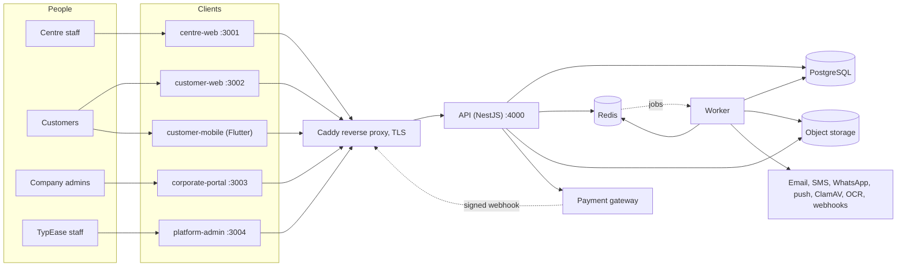
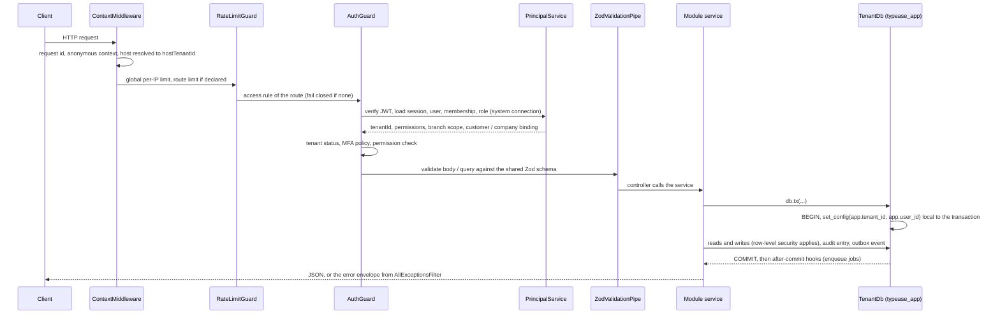
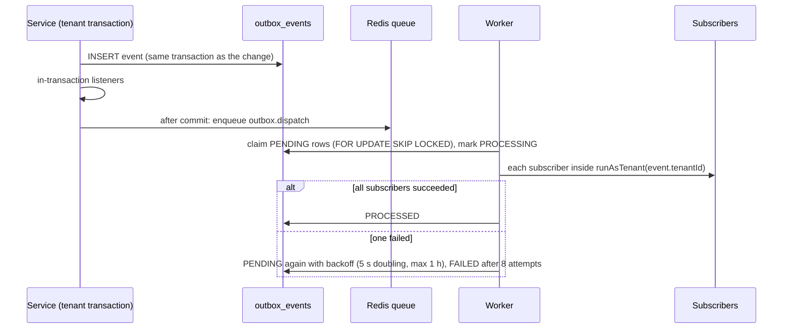
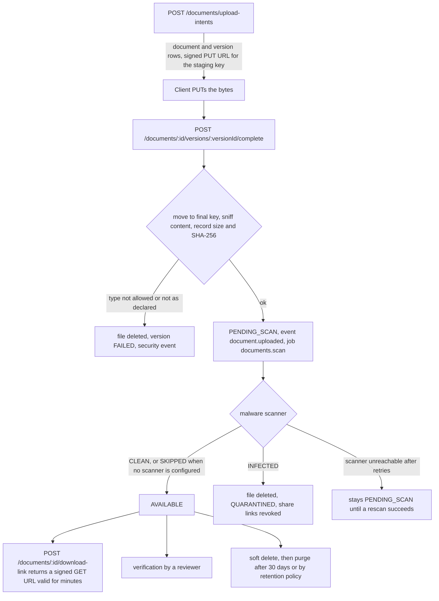
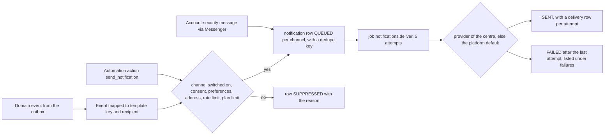

# Architecture

How TypEase is put together: the processes, how they talk, how a request travels through the API, what each
module owns, and the design decisions behind it with their costs. It describes the code in this repository
as it is; where something was written but never run, it says so.

For the conventions a contributor must follow see
[architecture/BACKEND_CONVENTIONS.md](architecture/BACKEND_CONVENTIONS.md) and
[architecture/FRONTEND_CONVENTIONS.md](architecture/FRONTEND_CONVENTIONS.md). For running it see the
[README](../README.md) and [DEPLOYMENT_GUIDE.md](DEPLOYMENT_GUIDE.md).

## Contents

1. [System context](#1-system-context)
2. [Components and how they talk](#2-components-and-how-they-talk)
3. [Repository layout](#3-repository-layout)
4. [A request through the API](#4-a-request-through-the-api)
5. [Module map](#5-module-map)
6. [Domain events, the outbox and jobs](#6-domain-events-the-outbox-and-jobs)
7. [Storage and the document pipeline](#7-storage-and-the-document-pipeline)
8. [Notification pipeline](#8-notification-pipeline)
9. [Workflow and automation engines](#9-workflow-and-automation-engines)
10. [White-label resolution](#10-white-label-resolution)
11. [Web and mobile clients](#11-web-and-mobile-clients)
12. [Configuration](#12-configuration)
13. [Observability](#13-observability)
14. [Scaling notes](#14-scaling-notes)
15. [Design decisions and trade-offs](#15-design-decisions-and-trade-offs)

## 1. System context

TypEase is a multi-tenant application for typing centres in the UAE. A centre ("tenant") registers
customers, takes service requests, collects and verifies documents, quotes, invoices, takes payments, and
tracks each case to completion. Four groups of people use it:

| Who | Through | Sees |
| --- | --- | --- |
| Centre staff (owner, manager, receptionist, operator, reviewer, accountant) | staff app `apps/centre-web` | their centre, within role, branch and assignment |
| Customers of a centre | customer portal `apps/customer-web`, mobile app `apps/customer-mobile` | their own record and cases |
| Company administrators of a centre's corporate customers | corporate portal `apps/corporate-portal` | their own company |
| TypEase staff | platform console `apps/platform-admin` | centres as accounts: plan, status, usage. Not their customer data ([TENANT_ISOLATION.md](TENANT_ISOLATION.md), section 5) |

External systems are reached only through adapters, and each adapter reports "not configured" when it has
no credentials: a payment gateway (Stripe), email (SMTP), SMS (Twilio or a generic HTTP gateway), WhatsApp
(Meta Cloud API), push (FCM), a malware scanner (ClamAV), an OCR engine (bundled Tesseract or an external
HTTP service), n8n or other webhooks, and S3-compatible object storage. None of these adapters was verified
against the real service in the build environment; they were exercised against local fakes or log drivers.

TypEase does **not** connect to any government portal. Work that happens at an authority is done by staff
outside the system and recorded in it ([WORKFLOW_DOCUMENTATION.md](WORKFLOW_DOCUMENTATION.md), section 13).



## 2. Components and how they talk

| Component | Technology | Talks to | Notes |
| --- | --- | --- | --- |
| API | NestJS 11 on Node 22, Prisma 7 client, Zod validation | PostgreSQL (two connections), Redis, object storage, payment gateway (checkout creation, refunds), SMTP / provider APIs for connection tests | REST under `/api/v1`. Stateless when the queue driver is BullMQ and storage is S3 |
| Worker | the same code base, started without an HTTP listener (`services/api/src/worker.ts`, launcher `services/worker`) | PostgreSQL, Redis, object storage, all notification providers, ClamAV, OCR, webhooks | consumes the BullMQ queue `typease`, runs schedules, dispatches the outbox. [architecture/WORKER.md](architecture/WORKER.md) |
| PostgreSQL | 16 (15 or newer required) | - | 107 tables, row-level security on all of them, three roles. [DATABASE_SCHEMA.md](DATABASE_SCHEMA.md) |
| Redis | 7 | - | rate-limit counters and the job queue. No sessions and no tenant data cache |
| Object storage | S3-compatible (two buckets), or an encrypted local directory | - | private documents; public brand assets |
| Web apps | four Next.js 15 apps (App Router, React 19, Tailwind) | the API over HTTPS; on tenant domains through their own origin (`/api/v1` rewrite) | server components resolve tenant and language; data fetching happens in the browser with TanStack Query |
| Mobile app | Flutter (Riverpod, go_router, Dio) | the API | source only: **never compiled or run** in the build environment |
| Reverse proxy | Caddy 2 | API and web apps | TLS, on-demand certificates for tenant hosts, blocks `/api/v1/internal/*`. Configuration validated statically only |
| Optional | ClamAV, n8n, Prometheus / Grafana / Loki / Alloy | - | Compose profiles; not started in the build environment |

Communication patterns:

- **Browser to API**: JSON over HTTPS with a bearer access token kept in memory; the refresh token is an
  HttpOnly cookie scoped to `/api/v1/auth`. Files go browser to object store directly through signed URLs
  (or through the API with the local storage driver).
- **API to worker**: never directly. The API writes a domain event to the outbox table or enqueues a job in
  Redis; the worker picks it up.
- **Module to module inside the API**: a module reads other modules' tables but writes only its own; changes
  that concern another module travel as domain events (section 6) or through a small port interface
  (`common/ports.ts`, `Messenger`, `OfficialSubmissionPort`).
- **Gateway to API**: signed webhooks on public routes.

In **single-process mode** (`QUEUE_DRIVER=inline`, `QUEUE_INLINE_AUTORUN=true`) the API runs jobs and
schedules itself and no worker is started. It is meant for development, demos and very small installations
with one API process.

## 3. Repository layout

```
apps/
  centre-web/         staff app (Next.js)
  customer-web/       customer portal (Next.js)
  corporate-portal/   company portal (Next.js)
  platform-admin/     TypEase console (Next.js)
  customer-mobile/    Flutter app (not in the pnpm workspace)
services/
  api/                NestJS API; also contains the worker entry point and the CLI programs
  worker/             thin launcher for the worker
database/
  prisma/schema.prisma   data model (Prisma is the typed client only)
  migrations/            hand-reviewed SQL
  scripts/               migration runner, SQL generator, RLS classification
  seed/                  demo data definitions
packages/
  types/              generated entity types + shared constants (state machine, events)
  validation/         Zod schemas shared by API and web apps
  permissions/        permission catalogue and default roles
  api-client/         fetch client, session manager, typed endpoint groups
  ui/                 design system, shells, auth screens, i18n
  branding/           colour tokens, logo, white-label theme maths
  config/             shared Next.js configuration and security headers
infrastructure/       Dockerfiles, Caddy, monitoring, env templates
scripts/              development, deployment, backup and verification scripts
tests/                acceptance suite (integration, security); e2e folder empty
docs/                 this documentation
```

## 4. A request through the API



Step by step (`services/api/src/app.module.ts`, `bootstrap.ts`, `common/`):

1. **`helmet`, CORS, body limit.** Security headers on every response; CORS allows the four app origins,
   `CORS_ORIGINS`, tenant sub-domains and verified custom domains, with credentials; JSON bodies are limited to
   1 MB. One proxy hop is trusted for the client address.
2. **`ContextMiddleware`** opens an `AsyncLocalStorage` context: request id (taken from `X-Request-Id` when
   well-formed, otherwise generated, and always echoed), client address, user agent, the app that calls
   (`X-Client-App`), and the tenant the host belongs to. No tenant is bound yet. It also writes one access-log
   line per request when `LOG_FORMAT=json`.
3. **`RateLimitGuard`**: a global limit per client address (`RATE_LIMIT_GLOBAL_PER_MINUTE`, default 600) and
   the route's own `@RateLimit` bucket, counted in Redis.
4. **`AuthGuard`** reads the route's access declaration. Every route must have exactly one of `@Public`,
   `@Internal`, `@Authenticated`, `@Permissions`, `@AllPermissions`, `@TenantMember`, `@Platform`
   ([API_DOCUMENTATION.md](API_DOCUMENTATION.md), section 4); a route without one is refused.
5. **`PrincipalService`** turns the token into a security context by reading the session, the user, the
   membership and the role from the database on every request.
6. **Validation**: request DTOs are generated from the Zod schemas in `packages/validation`, the same schemas
   the web forms use.
7. **Service code** runs inside `TenantDb.tx()`: one transaction, the tenant bound for row-level security,
   the audit entry and any domain event written in the same transaction as the change.
8. **Errors** leave through one filter as `{ statusCode, code, message, details?, requestId }`.

Background work enters the same way minus HTTP: `JobQueue.execute` creates a context with the tenant from the
job payload (`runAsTenant`) or a system context, then calls the handler.

## 5. Module map

`services/api/src/modules/<name>/`. Modules are discovered from the folder structure; `auth`, `tenancy` and
`health` are loaded by `AppModule` itself. `TYPEASE_MODULES=a,b` restricts loading for focused test runs.

| Module | Responsibility | Reference |
| --- | --- | --- |
| `auth` | Sign-in (password, phone OTP), MFA (TOTP + recovery codes), refresh-token rotation, sessions, registration, email / phone verification, password reset, invitations | [API_DOCUMENTATION.md](API_DOCUMENTATION.md), section 3 |
| `tenancy` | Centre sign-up and onboarding, branches, staff and schedules, roles, branding, custom domains, tenant resolution, provisioning of defaults | [WHITE_LABEL_GUIDE.md](WHITE_LABEL_GUIDE.md); `tenancy.controller.ts` |
| `health` | `GET /health` (liveness), `GET /health/ready` (PostgreSQL both roles, Redis) | - |
| `customers` | Profiles, search, duplicate detection, merge, notes, tags, contacts, consents, portal invitations, self-service | [api/modules/customers.md](api/modules/customers.md) |
| `corporate` | Company accounts, verification and credit, authorised contacts, employees, agreements, contract prices, corporate portal | [api/modules/corporate.md](api/modules/corporate.md) |
| `catalogue` | Categories, document types, services, prices, requirements, dynamic forms, portal and public catalogue | [api/modules/catalogue.md](api/modules/catalogue.md) |
| `workflows` | Workflow definitions, versions, validation, templates | [api/modules/workflows.md](api/modules/workflows.md) |
| `requests` | Cases: drafts, state machine, guards, assignment, checklist, review, external references, comments, public tracking, workflow execution engine | [api/modules/requests.md](api/modules/requests.md), [workflows/REQUEST_LIFECYCLE.md](workflows/REQUEST_LIFECYCLE.md) |
| `documents` | The vault: upload intents, content checks, malware scan, versions, verification, sharing, deletion and purge, access log | [api/modules/documents.md](api/modules/documents.md) |
| `storage` | Object-storage drivers (S3, encrypted local) and the signed-URL endpoints of the local driver | [api/modules/documents.md](api/modules/documents.md), section 8 |
| `ocr` | Suggested field values from documents (MRZ, Emirates ID, trade licence), human review and apply, usage | [api/modules/ocr.md](api/modules/ocr.md) |
| `finance` | Quotations, invoices, payments, online payments and webhooks, refunds, credit notes, expenses, liabilities, reconciliation, PDFs | [api/modules/finance.md](api/modules/finance.md) |
| `subscriptions` | Plans, coupons, a centre's subscription with TypEase, subscription invoices, lifecycle job, platform billing | [api/modules/subscriptions.md](api/modules/subscriptions.md) |
| `appointments` | Slot calendars, closures, bookings by staff, customers and guests, reminders, no-shows | [api/modules/appointments.md](api/modules/appointments.md) |
| `queue` | Walk-in tokens, counters, statistics, the public display with a server-sent-event stream | [api/modules/queue.md](api/modules/queue.md) |
| `tasks` | Manual, workflow, automation and escalation tasks; role queues | [api/modules/tasks.md](api/modules/tasks.md) |
| `notifications` | Templates, recipients, consent and suppression, delivery with retries, inbox, preferences, device tokens | [api/modules/notifications.md](api/modules/notifications.md) |
| `reminders` | Document-expiry reminder schedules and the daily scan | [api/modules/reminders.md](api/modules/reminders.md) |
| `automation` | Rules (trigger, conditions, actions), executions, retries, dead letters, signed webhooks | [api/modules/automation.md](api/modules/automation.md) |
| `reports` | Fifteen operational and financial reports, drill-down, export, scheduled reports | [api/modules/reports.md](api/modules/reports.md) |
| `dashboard` | The staff dashboard widgets and trends (live queries) | [api/modules/dashboard.md](api/modules/dashboard.md) |
| `support` | Customer tickets with SLA, feedback, tickets from a centre to TypEase, the platform support desk | [api/modules/support.md](api/modules/support.md) |
| `audit` | Read-only viewer and CSV export of the centre's audit trail | [api/modules/audit.md](api/modules/audit.md) |
| `privacy` | Data subject requests, export, erasure, retention policies, consent overview, incident and processor registers | [api/modules/privacy.md](api/modules/privacy.md) |
| `integrations` | Configuration and credentials of external services per centre, connection tests, partner and government authorisation records, approved providers | [api/modules/integrations.md](api/modules/integrations.md) |
| `platform` | Platform console: centres, approval, suspension, offboarding, support access, feature flags, settings, platform staff, platform audit, metrics | [api/modules/platform.md](api/modules/platform.md) |

Shared infrastructure in `services/api/src/common/` (global `CoreModule`): `TenantDb` / `SystemDb`,
`RedisService`, `RateLimiter`, `JobQueue`, `DomainEvents`, `AuditService`, `SequenceService`, `Messenger`,
`PrincipalService`, `UsageService` (plan limits and features), `TenantDirectory`.

Which module writes which tables is listed in
[architecture/BACKEND_CONVENTIONS.md](architecture/BACKEND_CONVENTIONS.md), section 6.

## 6. Domain events, the outbox and jobs

### Events

A module announces a change with `events.emit(tx, type, payload)` inside its business transaction. The
catalogue of event types is `DOMAIN_EVENTS` in `packages/types/src/events.ts`. Two kinds of consumers exist:

| Consumer kind | Registered with | Runs | Use |
| --- | --- | --- | --- |
| In-transaction listener | `events.on(type, listener)` | immediately, in the emitter's transaction | keeping another aggregate consistent, for example the request's payment status and workflow after `payment.completed`. The requests module runs each reaction in its own savepoint so that its failure does not undo the payment |
| After-commit subscriber | `events.subscribe(name, types, handler)` | later, from the outbox, at least once | notifications, automations, reminders, "last activity" on customers. Handlers must be idempotent |



The event is stored in the same transaction as the change, so it exists if and only if the change committed.
The worker also runs the dispatcher on an interval (`WORKER_OUTBOX_INTERVAL_MS`) to pick up events whose
job was lost and retries that became due. A row stuck in `PROCESSING` for five minutes is claimed again.
Because one failing subscriber puts the whole event back, the other subscribers see the event again: that is
why every subscriber deduplicates (notifications by a dedupe key, automations by a unique rule + event row).

### Jobs

`JobQueue` (`common/jobs/job-queue.ts`) is the only way to run something later. Handlers are registered by
the owning module at start-up; recurring work is declared with `jobs.schedule(...)`. With the `bullmq` driver
jobs go to the Redis queue `typease` and the worker executes them with retries and exponential backoff; jobs
that used up their attempts stay in BullMQ's failed set for 14 days. With the `inline` driver they are kept in
the memory of the process. The complete list of recurring and on-demand jobs, their schedules and failure
handling is in [architecture/WORKER.md](architecture/WORKER.md).

## 7. Storage and the document pipeline



- The JSON API never returns file bytes or storage keys; clients receive short-lived signed URLs.
- Keys are `<tenantId>/<random>`; uploads land in a staging prefix and are promoted by the server.
- The declared type is never trusted: the server reads the stored bytes and compares the detected type
  (magic bytes) with the declaration and the allow-list (`UPLOAD_ALLOWED_MIME`).
- Drivers: `s3` (presigned URLs, server-side encryption header) and `local` (AES-256-GCM in the application,
  signed tickets served by the API). The S3 driver was tested for request signing only, not against a bucket.
- With `MALWARE_SCANNER=none` files are marked `SKIPPED`, never `CLEAN`. With `REQUIRE_CLEAN_SCAN=true` only
  `CLEAN` files can be downloaded.
- Other modules store generated files (PDF summaries, exports, scheduled reports) through `DocumentStorePort`.
- OCR is a separate, optional job on an available document and only produces suggestions for a person to
  review.

Details: [api/modules/documents.md](api/modules/documents.md), [api/modules/ocr.md](api/modules/ocr.md).

## 8. Notification pipeline



- Only the notifications module writes notifications; other modules emit events.
- Templates exist per event, channel and language (English and Arabic defaults for email and in-app, SMS and
  WhatsApp variants for some events); a centre can override them.
- Provider per channel: the centre's own active integration, otherwise the platform default from the
  environment. With the `log` driver (development) the text is written to the log; in production a missing
  provider fails the delivery, it is never reported as sent.
- Account-security messages (verification, reset, OTP, invitation) ignore preferences and limits; their
  secret content is stored encrypted until sent and then removed.

Details: [api/modules/notifications.md](api/modules/notifications.md).

## 9. Workflow and automation engines

Two engines sit on top of the request **state machine**, which is code and cannot be configured
(`packages/types/src/requests.ts`):

- The **workflow engine** (`requests/workflow-engine.service.ts`) follows a centre-defined, versioned list
  of steps and asks the state machine for transitions. A refusal by a guard is not an error: the step waits.
- The **automation engine** (`modules/automation`) reacts to events with configured actions. Each action
  calls the service of the module that owns the data, as the `AUTOMATION` actor without permissions, so
  consent, plan limits, guards and audit apply. Events caused by an automation never start another rule.

Both are described in [WORKFLOW_DOCUMENTATION.md](WORKFLOW_DOCUMENTATION.md).

## 10. White-label resolution

1. The portal server component reads the request host. A host of the form `<slug>.<PLATFORM_BASE_DOMAIN>`
   or a verified custom domain selects the centre; otherwise `?tenant=<slug>` (remembered in a cookie), the
   cookie, or a configured default (`apps/customer-web/lib/tenant.ts`).
2. It fetches `GET /api/v1/public/tenant-config`, which returns name, logo, colours and contact details. The
   API returns the centre's own colours and logo only when the plan includes white label **and** the centre
   switched the mode on; otherwise the TypEase palette.
3. The root layout inlines CSS variables derived from the three brand colours (`packages/branding`), adjusted
   so that text contrast holds whatever colours were chosen.
4. On a centre's own host the browser calls the API through the portal's origin, so the refresh cookie is
   first-party.

The staff app applies the centre's branding after sign-in. The platform console is always TypEase-branded.
The reverse proxy issues certificates on demand only for hosts the API confirms. Full description:
[WHITE_LABEL_GUIDE.md](WHITE_LABEL_GUIDE.md).

## 11. Web and mobile clients

- **Shared packages.** `packages/ui` (components, data table, shells, auth screens, dictionaries),
  `packages/api-client` (fetch wrapper with token refresh, retry-once on 401, cross-tab coordination,
  idempotency keys, three-step upload helper), `packages/validation` (the API's own Zod schemas),
  `packages/permissions`, `packages/types`. The typed endpoint groups of the API client are written by hand
  against the API; they are not generated from the OpenAPI file.
- **Rendering.** Each route is a server file (metadata) plus a client component. Each app's middleware issues
  a Content-Security-Policy with a per-request nonce, so pages are rendered on demand.
- **Languages.** English and Arabic with right-to-left layout in all four apps; a test fails when a key is
  missing in one language. API error messages are English; the apps translate the codes they know.
- **State of the screens.** All four web apps have every route built (`grep -rl "TEMPORARY MARKER" apps/*/app`
  finds nothing). The corporate portal was completed last and has had the least checking. No browser
  end-to-end suite exists; how the screens were verified is recorded in [TEST_REPORT.md](TEST_REPORT.md),
  section 2.7.
- **Mobile.** One Flutter code base for Android and iOS, branded at run time from the tenant configuration,
  response models written by hand against captured API responses, no code generation. It has never been
  compiled; see `apps/customer-mobile/README.md` for the verification status and
  `apps/customer-mobile/ARCHITECTURE.md` for its structure.

## 12. Configuration

| Layer | Where | Examples |
| --- | --- | --- |
| Process environment | `services/api/src/config/env.ts`, validated at start; documented in [`.env.example`](../.env.example) | URLs, database connections, secrets, queue and storage drivers, platform default providers, upload limits, authentication policy |
| Production start-up rules | same file | refuses to start with sandbox payments, development tokens, insecure cookies, optional MFA, the default internal token, placeholder or weak secrets (`JWT_ACCESS_SECRET`, `HMAC_KEY`, `DATA_ENCRYPTION_KEY` and every old key, `INTERNAL_API_TOKEN`; one value reused for two purposes), or S3 storage without credentials. In every environment the encryption keyring (`DATA_ENCRYPTION_KEY`, `DATA_ENCRYPTION_KEY_ID`, `DATA_ENCRYPTION_OLD_KEYS`) is parsed at start |
| Platform settings | table `platform_settings` (allow-listed keys), platform console | subscription policy, approved integration providers, support-access policy, offboarding policy |
| Plans | table `subscription_plans` | limits and features per plan; enforced through `UsageService` |
| Feature flags | table `feature_flags` | global default and per-centre override |
| Centre settings | `tenants.settings` (JSON) and columns of `tenants` | request number prefix, quotation validity, invoice due days, automatic assignment, appointment and queue settings, notification switches, tax rate, AI switch |
| Centre integrations | table `integration_credentials_metadata` | own SMTP, SMS, WhatsApp, push, payment gateway; credentials encrypted |
| Web apps | `apps/<app>/.env.example`; `NEXT_PUBLIC_API_URL` is fixed at build time | API URL, storage origins for the CSP, default tenant slug |
| Mobile | `--dart-define` values | API URL, optional tenant lock |

The API does not read `.env` files; variables must be in the process environment.

## 13. Observability

| Signal | What exists |
| --- | --- |
| Logs | pino; one JSON object per line in production with `requestId`, `tenantId`, `userId`; one access-log line per request with the route pattern (no query string, no bodies); defensive redaction of credential and identity-number fields |
| Correlation | `X-Request-Id` on every response and in every error body |
| Health | API `GET /health`, `GET /health/ready`; worker `GET /health`, `/health/live` on its own port |
| Metrics | `GET /api/v1/internal/metrics` (Prometheus text, internal token): centres by status, outbox and queue depth, failed notifications, process memory. **No HTTP request counts or latencies and no per-tenant metrics** are instrumented in the API; request rates come from the proxy |
| Audit trail | `audit_logs` (append-only), written in the transaction of the change; viewer and CSV export per centre; platform-level entries for the console |
| Security events | `security_events` (append-only): failed sign-ins, lockouts, permission denials, refresh-token reuse, webhook signature failures, support access, malware, content mismatches |
| Tracing | none |
| Dashboards and alerts | Prometheus rules, Alertmanager, Grafana, Loki and Alloy configuration in `infrastructure/monitoring/`; parsed and validated statically, never run. [deployment/monitoring.md](deployment/monitoring.md) |

## 14. Scaling notes

Nothing here was load tested. Reasoning from the code:

- API, worker and web apps are stateless with `QUEUE_DRIVER=bullmq` and `STORAGE_DRIVER=s3` and can run as
  several replicas. Single-process mode and the local storage driver cannot.
- Every authenticated request costs a few indexed reads on the system connection (session, user, membership
  with role) before the business transaction. That is the price of immediate revocation.
- Each API or worker process opens two connection pools; plan
  `(API + worker processes) x 2 x DATABASE_POOL_MAX` connections.
- Gap-free numbering serialises transactions that take the same counter of the same centre.
- Per-centre recurring jobs visit centres one after another inside one job.
- Files are buffered in memory while they are checked (default limit 15 MB per file); OCR and PDF rendering
  are memory-hungry in the worker.
- The host-to-tenant cache is per process (30 seconds).

More in [deployment/scaling.md](deployment/scaling.md) and [architecture/WORKER.md](architecture/WORKER.md).

## 15. Design decisions and trade-offs

| Decision | Why | What it costs |
| --- | --- | --- |
| One shared database with row-level security, not a database per centre | One schema to migrate, cheap onboarding of small centres, cross-centre platform reporting | Isolation depends on policies, roles and discipline around the system connection; no per-centre backup, restore or data residency; a noisy centre shares resources with the others |
| Two runtime connections (`typease_app` under RLS, `typease_system` without) with a tested allow-list | Cross-tenant work (sign-in, billing, webhooks) needs to see more than one tenant; everything else should be unable to | Two pools per process; code on the allow-list must filter by tenant itself |
| Tenant bound per transaction with `set_config(..., true)` | Safe with pooled connections; nothing leaks to the next request | All tenant access must go through `TenantDb.tx()`; long transactions hold a connection |
| Session, user and membership re-read on every request | Revocation, suspension and role changes apply immediately; a stolen access token dies with the session | Extra database reads per request; the access token is not self-sufficient |
| Refresh token rotation with reuse detection; cookie for browsers, body for mobile | Limits the value of a stolen refresh token | A client that retries a refresh after a lost response can lose its session family |
| Hand-written SQL migrations, Prisma as client only | RLS, triggers, partial indexes and checks cannot be expressed in the Prisma schema; every statement is reviewed | No generated down migrations; the Prisma schema and the SQL must be kept in step by hand (the generator prints a starting point) |
| Integrity rules in the database (immutability triggers, append-only tables, check constraints) | A bug or a manual query cannot silently rewrite an issued invoice or the audit trail | Corrections need explicit documents (credit notes, refunds); the purge path needs a guarded exception |
| A modular monolith; the worker is the same code base without HTTP | One deployable to reason about; job handlers live next to the code that enqueues them | API and worker must be deployed from the same build; no independent scaling per module |
| Transactional outbox in PostgreSQL instead of a message broker | Events are atomic with the change; one less system to run | At-least-once delivery, so every subscriber must be idempotent; a failing subscriber delays the others for that event; throughput is bounded by the database |
| The request state machine is code; workflows are configuration on top | A centre cannot configure its way around a permission, a payment rule or the government-services policy | New statuses or edges need a release |
| Money as `DECIMAL(14,2)` and strings in JSON | No floating-point errors | Clients must not do arithmetic on amounts; totals come from the API |
| Gap-free per-centre numbering through a locked counter row | Invoice and receipt numbers without gaps | Serialisation on that counter |
| Files never pass through the JSON API; signed URLs with a staging area | Large files do not load the API; a leaked upload link cannot replace a checked file | The S3 path depends on correct bucket configuration (private, CORS, lifecycle) that the application does not set up; the multipart and local-driver paths do pass through the API |
| External services behind adapters that say "not configured" | Nothing pretends to work without credentials | Every adapter still has to be proven against its real provider before go-live |
| No government portal automation; statuses carry their source | Required by the product policy; avoids misrepresentation | Staff type references and statuses by hand; `VERIFIED_OFFICIAL` is unreachable until a deployment adds an authorised adapter |
| White-label colours are corrected for contrast instead of rejected | A centre cannot make its portal unreadable | The colour on screen can differ slightly from the colour entered |
| PDFs with pdfkit and built-in fonts | No headless browser in the worker | PDFs are English / Latin-1 only; Arabic text is not rendered |
| Flutter app without code generation, written against captured responses | Could be written without the SDK | It was never compiled; the first build is development work |
| Single-process mode | A centre can be demonstrated with PostgreSQL and Redis only | Jobs in memory are lost on restart; cron schedules run hourly; one API process only |
