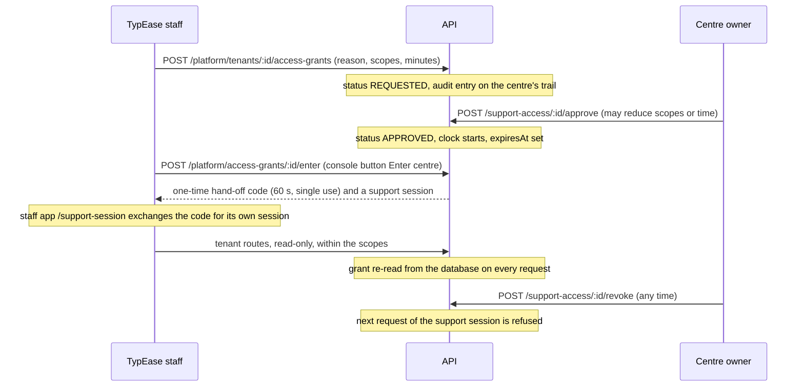

# Tenant isolation

How TypEase keeps the data of one typing centre (a "tenant") away from every other centre, from customers of
the same centre who do not own it, and from TypEase's own staff. This document is for engineers adding code,
for operators, and for reviewers who need to see exactly what is enforced, where, and how it was checked.

TypEase uses **one shared PostgreSQL database and one shared schema** for all centres. It does not give each
centre a separate database, and no document in this repository should be read as saying so. Isolation rests
on a mandatory tenant column, PostgreSQL row-level security with separate database roles, and application
rules on top.

No independent security review or penetration test of this design or its implementation has been performed.
What is described below was checked by the automated tests named in section 8 and by the manual queries of
section 9. Test results are reported in [TEST_REPORT.md](TEST_REPORT.md).

Related documents: [DATABASE_SCHEMA.md](DATABASE_SCHEMA.md) (every table with its scope class),
[ROLE_PERMISSION_MATRIX.md](ROLE_PERMISSION_MATRIX.md) (permissions inside a tenant),
[SECURITY_CHECKLIST.md](SECURITY_CHECKLIST.md), [ARCHITECTURE.md](ARCHITECTURE.md).

## Contents

1. [Threat model](#1-threat-model)
2. [How the tenant of a request is determined](#2-how-the-tenant-of-a-request-is-determined)
3. [Enforcement in the database](#3-enforcement-in-the-database)
4. [Enforcement in the application](#4-enforcement-in-the-application)
5. [Platform staff and support access](#5-platform-staff-and-support-access)
6. [Files, queue, caches, search, logs and backups](#6-files-queue-caches-search-logs-and-backups)
7. [Background jobs, events and webhooks](#7-background-jobs-events-and-webhooks)
8. [What the automated tests assert](#8-what-the-automated-tests-assert)
9. [Verifying isolation by hand](#9-verifying-isolation-by-hand)
10. [Limits and operator responsibilities](#10-limits-and-operator-responsibilities)

## 1. Threat model

| Who | What they might try | What stops it |
| --- | --- | --- |
| A signed-in user of centre A (staff, customer or company user) | Read or change a record of centre B by guessing or copying its id; send a tenant id in the body, query or path; reference a row of centre B from a new row of centre A | The tenant is never taken from the request (section 2); row-level security hides centre B's rows from every statement (section 3); a database trigger rejects foreign keys that cross tenants (section 3.3); a lookup that finds nothing answers `404`, never `403` |
| A customer of centre A | Read another customer's request, document or invoice in the same centre | Ownership scope in the services (`ownCustomerId()`, `ownCorporateAccountId()`), tested per module. This is inside the tenant and therefore not row-level security; see [ROLE_PERMISSION_MATRIX.md](ROLE_PERMISSION_MATRIX.md), section 8 |
| Staff limited to a branch, or an operator limited to assigned cases | Read cases of another branch or of a colleague | Branch and assignment scope in the services |
| An unauthenticated visitor | Use a host name or a slug to obtain data | Host and slug only select public presentation data (name, colours, public catalogue); they never authorise anything |
| TypEase platform staff | Browse a centre's customers or documents from the platform console | Platform roles hold no tenant permission; the console reads centre metadata only; tenant data needs a time-limited grant the centre approves (section 5) |
| A bug in application code | A query without a tenant filter; a job that runs for the wrong tenant | Row-level security applies to every statement of the tenant connection whatever the query says; a job runs inside the tenant named in its payload; only allow-listed files may use the connection that is not restricted (section 4.2) |
| Someone holding a leaked signed file link | Fetch a file | Links live for minutes, are bound to one object key, and upload links write to a staging area (section 6.1) |

Out of scope of these controls: a compromise of the database server, of the schema-owner or system role
credentials, or of the API process itself. An attacker who can run code in the API holds both database
connections. Encryption of identity numbers and files at rest limits what a stolen database dump or disk
reveals (see [SECURITY_CHECKLIST.md](SECURITY_CHECKLIST.md)); it does not protect against a compromised API.

## 2. How the tenant of a request is determined

The tenant comes from the verified session, never from client input.

1. `ContextMiddleware` opens an anonymous request context: no tenant, no permissions. It notes which centre
   the request's host belongs to (`hostTenantId`, from `X-Tenant-Host` or the `Origin` header). That value is
   used for public pages only.
2. `AuthGuard` verifies the access token (HS256, issuer and audience checked). The token carries the session
   id, and for a tenant session the tenant id and the membership id it was issued for.
3. `PrincipalService.resolve` then loads, from the database and on every request: the session (not revoked,
   not expired), the user (active), and the membership (same user, same tenant, status `ACTIVE`, and the one
   the session was created for) with its role and permissions. Only then is `tenantId` written into the
   context. A forged or stale tenant id in a token cannot survive this step, and suspending a member or
   revoking a session takes effect on the next request rather than when the token expires.
4. The tenant's status is checked: staff may work while the centre is `ONBOARDING`, `PENDING_APPROVAL`,
   `TRIAL`, `ACTIVE` or `PAST_DUE`; customers and company users only in `TRIAL`, `ACTIVE`, `PAST_DUE`. A few
   routes are marked `allowSuspended` so that an owner can still read why the centre is suspended and pay.

At sign-in the centre is chosen like this: staff accounts belong to their centre (a person with several
memberships gets a `SELECT_TENANT` answer and chooses); the customer and corporate portals pass the slug of the
centre the portal is showing, or rely on the host. A customer of centre A who tries to sign in on centre B's
portal gets `403 NO_ACCESS`, because no membership exists there.

Rules that follow from this, each checked by a test:

- No controller reads `tenantId` from `@Body`, `@Query` or `@Param`
  (`test/architecture.spec.ts`, "no module reads a tenant id from the request body, query or params").
- Portal routes have no customer or company id in the path: `/me/customer`, `/corporate/account`. The record is
  the one bound to the membership.
- Ids of other tenants in a body (a `customerId`, `branchId`, `documentId` ...) are looked up inside the
  caller's tenant first and answer `404`.

Where a tenant is taken from something other than a session, it is for public or machine endpoints only:

| Endpoint | Tenant comes from | What it can reach |
| --- | --- | --- |
| `GET /public/tenant-config`, `/public/services`, `/public/appointments/*` | slug, or the portal host | public presentation, the public catalogue, guest booking when the centre enabled it |
| `POST /public/track` | slug or host, plus request number and tracking code | status and timeline of that one request; wrong code, unknown number and another centre all answer the same `404` |
| `POST /auth/login`, `/auth/register` | slug or host | which centre the person is signing in to; access still requires a membership |
| `POST /public/webhooks/payments/:gateway` | the payment row the event refers to | that payment, after the signature was verified with that centre's own secret |
| `GET /public/queue/display` | a signed display token bound to tenant and branch | token numbers and counters of that branch, nothing else |
| `GET /public/shared-documents/:token` | the share link's token hash | one document, within the link's time and download limits |

## 3. Enforcement in the database

Details of every table are in [DATABASE_SCHEMA.md](DATABASE_SCHEMA.md), section 2. In short:

### 3.1 Three roles

| Role | Connection | Used for | Row-level security |
| --- | --- | --- | --- |
| `typease_app` | `DATABASE_URL` | every tenant request and tenant job | enforced |
| `typease_system` | `DATABASE_SYSTEM_URL` | cross-tenant code only | a policy that allows everything; still an ordinary role, not a superuser |
| `typease_owner` | `DATABASE_MIGRATION_URL` | migrations, backups, the readiness check | owns the tables, so policies do not apply |

The API and worker containers of the production Compose stack do not receive `DATABASE_MIGRATION_URL`.
`typease_app` must not be a superuser, must not have `BYPASSRLS` and must own no table: the migration runner
refuses to finish otherwise, the API refuses to start in production, and
[`scripts/production-readiness.mjs`](../scripts/production-readiness.mjs) checks it again together with role
memberships.

### 3.2 Row-level security

Row-level security is enabled on all 107 tables. For the 90 tenant tables the policy for `typease_app` is

```sql
CREATE POLICY tenant_isolation ON "<table>" FOR ALL TO typease_app
  USING ("tenantId" = app_tenant_id()) WITH CHECK ("tenantId" = app_tenant_id());
```

`app_tenant_id()` reads the transaction-local setting `app.tenant_id`. `USING` hides other tenants' rows from
`SELECT`, `UPDATE` and `DELETE`; `WITH CHECK` rejects an `INSERT` or `UPDATE` that would write another
tenant's id. When nothing is bound the function returns NULL and the comparison is never true: a tenant
connection without a bound tenant sees no tenant rows at all.

Other classes: eight **system-only** tables (sessions, one-time tokens, sign-in history, coupons, platform
settings, webhook events, the incident and processor registers) are not granted to `typease_app` at all; five
tables additionally let every centre **read** platform defaults (rows with a NULL tenant); two reference
tables are read-only for everyone; `users` exposes only non-credential columns, and only of the caller and
of people who are members of the bound tenant; a centre can read its own `tenants` row and update only its
self-service columns.

Billing state (`subscriptions`, `subscription_invoices`, `subscription_events`), feature flags, domain
verification state and the creation of support access grants are platform-controlled: the tenant role has
read-only or reduced grants there.

### 3.3 Cross-tenant foreign-key guard

Row-level security does not check where a foreign key points. The trigger `same_tenant_guard` does: on 61
tables it checks 104 foreign-key columns on every insert and update and raises
`cross-tenant reference blocked: <table>.<column> -> <parent>` when the parent row belongs to another tenant.
It runs as `SECURITY DEFINER` so that row-level security cannot hide the parent it has to inspect. The API
answers such an error with `403 TENANT_FORBIDDEN`; in normal operation the service has already answered
`404` because it looks the parent up in the caller's tenant first.

The guard covers every relation declared between tenant-scoped tables. Id columns without a foreign key
(actor columns such as `createdById`, and a few soft references such as `tasks.branchId`) are not covered by
the trigger; services validate them.

## 4. Enforcement in the application

### 4.1 `TenantDb`

All tenant data access goes through `TenantDb.tx()` (`services/api/src/common/db/prisma.service.ts`):

```ts
await this.db.tx(async (tx) => {
  const customer = found(await tx.customer.findFirst({ where: { id, tenantId: this.db.tenantId } }), 'Customer');
  ...
});
```

- It refuses to run without a tenant in the context ("TenantDb used without a tenant in the request context").
- The first statement of the transaction is
  `SELECT set_config('app.tenant_id', <tenant>, true), set_config('app.user_id', <user>, true)`. The third
  argument makes the setting local to the transaction, so a pooled connection never carries a tenant over to
  the next request.
- Nested `tx()` calls join the outer transaction; a nested call for a different tenant throws.
- Services still write `tenantId` into every `where` and `create`. That is defence in depth and uses the
  indexes; row-level security is the backstop when someone forgets.
- The Prisma client of this connection omits the credential columns of `users`.

### 4.2 `SystemDb` and its allow-list

`SystemDb` connects as `typease_system` and is not restricted by row-level security. It exists for code that
is cross-tenant by nature. `test/architecture.spec.ts` ("only allow-listed files use the system (non-RLS)
database connection") scans the source tree and fails when any other file mentions it. The list at the time
of writing:

| Area | Files |
| --- | --- |
| Infrastructure | `common/db/prisma.service.ts`, `common/core.module.ts`, `common/audit.service.ts` (platform-level audit and security events), `common/auth/principal.service.ts` (session and membership lookup before a tenant is known), `common/events.service.ts` (outbox dispatcher), `common/tenant-directory.ts` (job fan-out), `index.ts` |
| Identity and tenancy | `modules/auth/auth.service.ts`, `modules/tenancy/tenant-resolver.service.ts`, `provisioning.service.ts`, `onboarding.service.ts`, `organisation.service.ts`, `branding.service.ts`, `modules/health/health.controller.ts` |
| Invitations | `modules/customers/portal.service.ts`, `modules/corporate/corporate-access.service.ts` (user placeholders for portal invitations) |
| Registers on system-only tables | `modules/privacy/incident.service.ts` |
| Erasure of one person in one centre | `modules/privacy/erasure-system.service.ts` (redacts the person's values in the append-only trails, which needs the controlled purge switch, and anonymises a login that is used for nothing else; every statement is filtered by the tenant of the erasure or by the person's own account ids) |
| Webhooks without a session | `modules/finance/payment-webhook.service.ts` |
| SaaS billing | `modules/subscriptions/billing.core.ts`, `plans.service.ts`, `subscriptions.service.ts`, `lifecycle.service.ts`, `subscription-webhook.service.ts` |
| Platform | `modules/support/platform-support.service.ts`, everything under `modules/platform/`, `modules/integrations/platform-integrations.service.ts`, `cli/` |

Adding a file to that list is a security decision and should be reviewed as one. Code on the system
connection must filter by tenant itself; the module documents state how each of these files does it (for
example, the platform support desk restricts every query to `scope = 'PLATFORM'`, and the incident service
filters every statement by the caller's tenant or by `tenantId IS NULL`).

Scheduled jobs do not use `SystemDb` to visit tenants. They call `TenantDirectory.forEachTenant()`, which
runs the callback once per centre inside that centre's context, so each centre's work happens on the
tenant connection under row-level security.

### 4.3 Scope inside a tenant

Row-level security separates centres. Inside a centre, the services narrow rows further
(`services/api/src/common/scope.ts`): staff limited to branches (`branchFilter`, `assertBranchAccess`),
operators limited to assigned requests, customers limited to their own customer record (`ownCustomerId`),
company users limited to their company (`ownCorporateAccountId`). Internal notes and staff-only fields are
left out of responses to customers. These rules are application code and are tested per module; they are
described in [ROLE_PERMISSION_MATRIX.md](ROLE_PERMISSION_MATRIX.md), section 8.

### 4.4 Every route declares who may call it

A route without an access declaration is refused at run time with `403 ACCESS_NOT_DECLARED`, and an
architecture test fails the build. `@Platform(...)` routes require a session with a platform role **and no
tenant**; tenant routes require a tenant. A centre user calling a platform route gets `403 PLATFORM_ONLY`; a
platform user calling a tenant route gets `403 TENANT_REQUIRED`.

## 5. Platform staff and support access

Platform administrators do not automatically see a centre's customers, documents, requests or finances.

**What the platform console can read without asking.** Routes under `/platform/*` return centre-level
metadata: profile and contact details, owners' names and contact data, subscription and billing history with
TypEase, usage against plan limits, counts of branches and staff, domains, onboarding progress, the centre's
platform support tickets, security events, and the authorisation records a centre submitted for review
(section 4 of [api/modules/integrations.md](api/modules/integrations.md)). They return no customers, no
documents, no request content and no customer-finance records. The centre's own audit entries, with their
before / after values, are not readable from the platform console either (`platform-audit.service.ts`
restricts every query to entries without a tenant).

**How support reaches tenant data.** Through an access grant (`access_grants`):



| Property | Implementation |
| --- | --- |
| Reason is mandatory | at least 10 characters, also enforced by a check constraint |
| Time limit | 5 to 1440 minutes (check constraint); the platform policy `supportAccess.policy` can lower the maximum; the clock starts at approval |
| Scopes | chosen from `SUPPORT_GRANTABLE` in `packages/permissions`: sixteen read-level permissions. Reading document content needs the explicit `document.read` scope |
| The centre decides | `support_access.decide` (the owner role by default). The centre may approve fewer scopes or a shorter time, never more. A support session cannot decide about access |
| Enforced on every request | `PrincipalService` requires the grant to be `APPROVED`, not revoked, not past `expiresAt`, and requested by this user; only its scopes become the session's permissions. `decideSupportAccess` (`services/api/src/common/auth/support-session.ts`) then refuses every route whose permission is not a granted scope (`403 SUPPORT_ACCESS_SCOPE`) and every method other than GET / HEAD (`403 SUPPORT_ACCESS_READ_ONLY`), with the exceptions listed below |
| Hand-off between origins | The console never puts a token in a URL: `enter` returns a one-time code (32 random bytes, stored hashed, valid 60 seconds) and the staff app's `/support-session` page exchanges it (`POST /auth/support-session/exchange`, anti-CSRF header required) for its own session. Guessed, reused or replaced codes answer `HANDOFF_INVALID` |
| Ends by itself | access stops at `expiresAt` whether or not the expiry job has run; the job `platform.access_grants_expiry` (every 60 seconds) marks grants `EXPIRED` and closes their sessions |
| Bound to one centre | the support session carries that tenant; `/platform/*` answers `403 PLATFORM_ONLY` from inside it |
| Logged | `support_access.requested`, `.approved`, `.denied`, `.entered`, `.revoked`, `.expired` on the centre's audit trail; every audited action under the grant carries `supportGrantId`, actor type `PLATFORM` and a label ending in "(TypEase support)"; document views and links additionally write `document.accessed_by_support`; security events `SUPPORT_ACCESS_*` |

What a support session can reach outside its scopes, stated so that nobody assumes otherwise:

- Routes without a permission (`@TenantMember()`, `@Authenticated()`: own profile, password, MFA, sessions,
  the dashboard, the personal inbox, plan usage, switching centre ...) are **closed**, except five marked
  `@SupportSessionSafe` in the code and pinned by `services/api/test/support-session.spec.ts`: `GET /auth/me`,
  `GET /tenant`, `GET /feature-flags`, `GET /document-types`, `GET /branches/directory`. None returns customer
  data; none is a change.
- Four POST routes that only return a short-lived link are allowed with their scope (`@SupportSessionRead`):
  document download and preview links (`document.read`), a scheduled report file link (`report.operational`),
  a renewal link (`reminder.read`).
- The scope `request.comment.internal` (`SUPPORT_WRITE_SCOPES`) allows writing an internal note on a request.
  It is the only state change a support session can perform; the note is stored with author type `PLATFORM`.
- A support session sees all branches of the centre.
- Every allowed call that reaches centre data writes `support_access.api_call` on the centre's audit trail
  (method, route, path, outcome); if that entry cannot be written the call is not carried out. Refused calls
  are recorded too.
- When a request for access arrives, every active member holding `support_access.decide` (the owners by
  default) gets an email and an in-app notification (`support_access.requested`), and the staff app shows the
  number waiting. The platform staff member who asked is told by email when the centre decides or ends the
  access. Delivery depends on a configured email provider; with the `log` driver nothing is sent.

The first platform administrator is created with a command, not through the API
(`pnpm --filter @typease/api platform-admin`, see
[user-guides/PLATFORM_ADMIN_GUIDE.md](user-guides/PLATFORM_ADMIN_GUIDE.md)). A platform account cannot share
an email address with a centre's account, so one sign-in is never both.

**Permanent deletion of a centre** (offboarding) is the one platform action that touches tenant data in bulk.
It is restricted to the Super Admin role, needs the typed slug and a reason, waits at least 30 days unless an
explicit second confirmation is typed, and is described in [api/modules/platform.md](api/modules/platform.md),
section 3.

## 6. Files, queue, caches, search, logs and backups

### 6.1 Object storage

| Aspect | Implementation |
| --- | --- |
| Key layout | `<tenantId>/<192-bit random>` for stored objects, `incoming/<tenantId>/<random>` for the staging area that upload links write to. Keys are generated by the server and validated against that pattern; they are never derived from a file name or other user input and never returned by the API |
| Buckets | one private bucket for all centres (`S3_BUCKET`), separated by key prefix, plus a public-read bucket for logos and favicons (`S3_PUBLIC_ASSETS_BUCKET`) whose keys are random and not tenant-prefixed. There is no bucket per tenant |
| Who may fetch | nobody directly. The API checks the caller's tenant and document access rules and then issues a signed URL for one key (download: `DOWNLOAD_URL_TTL_SECONDS`, default 120 s; upload: `UPLOAD_URL_TTL_SECONDS`, default 600 s) |
| Upload safety | the signed upload URL writes to the staging key; `complete` moves the object to its final key and then inspects it, so a leaked upload URL cannot overwrite a file that was already checked |
| Local driver | files under `STORAGE_LOCAL_DIR/private/<tenantId>/...`, encrypted with AES-256-GCM before they reach the disk; signed tickets are served by the API and upload tickets are single-use |
| Deleting a centre | `deleteTenantObjects` removes exactly the two prefixes of that tenant and refuses anything that is not a tenant id (`platform/storage-purge.unit.spec.ts`) |

Because all centres share one bucket, isolation of files depends on the API never issuing a link for a key of
another tenant. The key is always read from a `document_versions` row that the tenant connection could see.
The S3 driver was exercised against request-signing tests only, not against a live bucket (see
[api/modules/documents.md](api/modules/documents.md)).

### 6.2 Redis: rate limits and the job queue

Redis holds no tenant business data and no sessions (sessions are rows in PostgreSQL).

- **Rate-limit counters**: keys `rl:global:<ip>` and `rl:<bucket>:<ip>:<scope>`; one bucket is per tenant
  (`rl:integration-test:<tenantId>`). They contain a number.
- **Job queue**: one BullMQ queue named `typease` shared by all centres. A tenant job's payload carries
  `tenantId` and record ids only; `JobQueue.execute` runs the handler inside `runAsTenant(payload.tenantId)`,
  so the handler works on the tenant connection under row-level security. The one payload with content
  (account messages without a centre) is encrypted. Queue contents are visible to anyone with access to
  Redis: protect Redis as part of the trusted network (password, no public port).

### 6.3 In-process caches

There is no shared application cache of tenant data. Three small caches live in the memory of each API
process: host name to tenant id (30 seconds; holds ids only and is cleared when a domain is verified or
removed), the steps of immutable workflow versions by version id, and constructed notification-provider
objects keyed by a hash of their settings.

### 6.4 Search

There is no separate search engine or index. Every search is a PostgreSQL query on the tenant connection.
Identity numbers are found through a keyed blind index whose input includes the tenant id
(`HMAC(tenantId | kind | value)`), so the same Emirates ID at two centres produces two different index
values and cannot be correlated across centres.

### 6.5 Logs and metrics

Structured log lines carry `tenantId` and `userId` when written inside a request or job; request bodies are
not logged. Logs of all centres go to one stream. Prometheus metrics are platform totals; there are no
per-tenant metrics.

### 6.6 Backups

A database backup contains all centres. There is no per-tenant backup or restore: recovering one centre's
data means restoring the dump to a separate database and extracting rows by `tenantId`. See
[security/BACKUP_AND_RECOVERY.md](security/BACKUP_AND_RECOVERY.md).

## 7. Background jobs, events and webhooks

| Mechanism | How the tenant is bound |
| --- | --- |
| Queued tenant job | `payload.tenantId`, set by the code that enqueued it inside that tenant's request; the worker binds it before the handler runs. `platform/worker.bullmq.spec.ts` checks that a job enqueued by the API runs inside the right tenant |
| Recurring per-centre job | `TenantDirectory.forEachTenant`: one tenant context and one tenant transaction per centre; a failure in one centre does not stop the others |
| Domain event | written to `outbox_events` with the tenant of the transaction that emitted it; the dispatcher (system connection) runs each subscriber inside `runAsTenant(event.tenantId)` |
| Automation | rules and executions are tenant rows; an event of one centre can only match rules of the same centre; actions call the owning module's service inside the tenant |
| Payment webhook | the tenant is found from the payment row; the signature is verified with that centre's secret; the change runs in that centre's context. `finance.payments.spec.ts`: "a webhook can only ever touch the tenant that owns the payment" |
| Subscription lifecycle, offboarding, access-grant expiry | platform jobs on the system connection, by design cross-tenant; each statement is keyed by tenant or subscription id |

## 8. What the automated tests assert

The API tests boot the real application against a database built from the migration files by a
non-superuser owner, so the policies and triggers are the real ones. Every module's suite creates at least
two centres. The files and what they assert about isolation:

| File (under `services/api/`) | Asserts |
| --- | --- |
| `test/architecture.spec.ts` | only allow-listed files use `SystemDb`; no controller reads a tenant id from the request; every route declares an access rule; public routes are rate limited; the tenant connection is `typease_app`, not a superuser and without `BYPASSRLS`; database sessions run in UTC |
| `test/foundation.spec.ts` | tenant A cannot read or change tenant B's branches (`404`); an **unfiltered** query on the tenant connection returns only own rows; inserting a row with another tenant's id fails; a cross-tenant foreign key is rejected by the guard; the tenant connection cannot read `passwordHash` or `sessions` ("permission denied"); a customer of one centre cannot sign in to another or to the staff app; a domain cannot be claimed by two centres and is not routed before verification |
| `src/modules/customers/customers.spec.ts` | duplicate detection and merging never cross centres; customers reach only their own record; row-level security holds for an unfiltered query |
| `src/modules/corporate/corporate.spec.ts` | a company user sees only their own company, also against another company of the same centre; row-level security on every corporate table |
| `src/modules/requests/requests.access.spec.ts` | "no endpoint lets another centre read, change or reference a request"; unfiltered queries hide other centres' requests; customers and company users reach only their own |
| `src/modules/documents/documents.spec.ts` | another centre cannot see, download, change, share or delete a document; uploads cannot reference rows of another centre; row-level security on documents, versions and access logs; platform support needs the `document.read` scope |
| `src/modules/storage/storage.unit.spec.ts`, `platform/storage-purge.unit.spec.ts` | only `<tenantId>/<random>` keys are accepted; deleting a tenant's objects never touches a key outside its prefix |
| `src/modules/finance/finance.documents.spec.ts`, `finance.payments.spec.ts`, `finance.refunds.spec.ts` | quotations, invoices, payments, refunds, credit notes, expenses and reconciliations of another centre are `404`; own-rows access for customers and company users; a webhook only touches the owning tenant |
| `src/modules/subscriptions/subscriptions.spec.ts` | a centre cannot see or pay another centre's subscription; billing tables are read-only for the tenant connection |
| `src/modules/platform/platform.access.spec.ts` | without a grant, platform staff (including a Super Admin) cannot reach any tenant route; scopes limit what a grant allows; denial, revocation and expiry take effect on the next request |
| `src/modules/platform/platform.tenants.spec.ts` | the platform console shows centre-level metadata only |
| `src/modules/platform/platform.offboarding.spec.ts` | deleting one centre leaves every other centre untouched |
| `src/modules/platform/platform.admin.spec.ts` | a centre reads its own feature flags and the defaults, never another centre's, and cannot write any |
| `src/modules/audit/audit.spec.ts` | a centre never sees another centre's audit entries or platform-level entries |
| `src/modules/support/support.spec.ts` | tickets of another centre are unreachable; platform staff answer platform tickets without seeing customer data |
| `appointments`, `queue`, `tasks`, `reminders`, `notifications`, `automation` (`automation.rules.spec.ts`), `integrations`, `catalogue`, `reports` (`reports.spec.ts`, `reports.export.spec.ts`, `reports.scheduled.spec.ts`), `dashboard`, `ocr`, `privacy` spec files | each has a "tenant isolation" case: rows of another centre cannot be read, changed or referenced, and reports and exports contain only own rows |
| `src/modules/customers/customer-view.unit.spec.ts` | the blind index of an identity number is scoped to the tenant |
| `test/support-session.spec.ts` | every registered route is called in a support session: only routes whose permission is a granted scope answer, the five `@SupportSessionSafe` routes and the four link routes aside; every other method is refused as read-only |

The acceptance suite adds a second, cross-module layer over HTTP (`pnpm test:security`; scenario 24 in
[../tests/README.md](../tests/README.md)): `tests/security/01-tenant-isolation.spec.ts` attacks every route
that names a record with another centre's ids and fingerprints the other centre's rows before and after;
`02-customer-and-corporate-boundaries.spec.ts` does the same for customers, company administrators and
company employees inside one centre; `05-platform-support-access.spec.ts` covers grants, scopes, the hand-off
code and suspension; `06-row-level-security.spec.ts` runs raw SQL as `typease_app` over every tenant-owned
table. Results: [TEST_REPORT.md](TEST_REPORT.md).

The demo seed repeats five cross-tenant and cross-scope checks through the public API at the end of every
run and stops if one of them does not answer `404` ([DEMO_ENVIRONMENT.md](DEMO_ENVIRONMENT.md), section 4), and
`scripts/seed-verify.mjs` follows all 104 relations in the seeded database to confirm that none crosses
centres.

What these tests do not show: behaviour under a connection pooler in transaction mode (analysed in
[deployment/scaling.md](deployment/scaling.md), not tested), behaviour of the S3 driver against a real
bucket, and anything an adversarial tester would find that the authors did not think of.

## 9. Verifying isolation by hand

The steps use the demo data ([DEMO_ENVIRONMENT.md](DEMO_ENVIRONMENT.md)); the counts will differ in your
database.

### 9.1 Through the API

```bash
login() { curl -s localhost:4000/api/v1/auth/login -H 'content-type: application/json' \
  -d "{\"email\":\"$1\",\"password\":\"TypEase-Demo-2026\",\"app\":\"centre\"}" \
  | node -pe 'JSON.parse(require("fs").readFileSync(0)).accessToken'; }
A=$(login owner@al-noor.test); G=$(login owner@gulf-star.test)
ID=$(curl -s 'localhost:4000/api/v1/requests?pageSize=1' -H "authorization: Bearer $A" \
  | node -pe 'JSON.parse(require("fs").readFileSync(0)).data[0].id')
curl -s -w '\n%{http_code}\n' localhost:4000/api/v1/requests/$ID -H "authorization: Bearer $G"
```

Answer observed on the development machine:

```json
{"statusCode":404,"code":"NOT_FOUND","message":"Request was not found.","requestId":"f3e44e28-d8bf-49f9-921d-2b9c527a0416"}
```

A centre token on a platform route answers `403 PLATFORM_ONLY`; a platform token on a tenant route answers
`403 TENANT_REQUIRED`.

### 9.2 In the database, as the application role

Find two tenant ids as the schema owner (the application role cannot list tenants):

```sql
-- psql "$DATABASE_MIGRATION_URL"
SELECT id, slug FROM tenants WHERE slug IN ('al-noor', 'gulf-star');
```

Then connect with the application's own credentials (`psql "$DATABASE_URL"`) and run:

```sql
SELECT current_user,
       (SELECT rolsuper     FROM pg_roles WHERE rolname = current_user) AS superuser,
       (SELECT rolbypassrls FROM pg_roles WHERE rolname = current_user) AS bypass_rls;
-- typease_app | f | f

-- 1. Nothing is visible without a bound tenant
SELECT count(*) FROM customers;      -- 0
SELECT count(*) FROM tenants;        -- 0
SELECT count(*) FROM audit_logs;     -- 0

-- 2. System-only tables and credential columns are not readable at all
SELECT count(*) FROM sessions;                  -- ERROR: permission denied for table sessions
SELECT "passwordHash" FROM users LIMIT 1;       -- ERROR: permission denied for table users

-- 3. Bind one tenant for one transaction, exactly as TenantDb does
BEGIN;
SELECT set_config('app.tenant_id', '<al-noor id>', true);
SELECT count(*) FROM customers;                                         -- only Al Noor's customers
SELECT count(*) FROM customers WHERE "tenantId" = '<gulf-star id>';     -- 0
SELECT count(*), min(slug) FROM tenants;                                -- 1 | al-noor
SELECT count(*) FROM document_types WHERE "tenantId" IS NULL;           -- platform defaults are readable
COMMIT;

-- 4. The binding ended with the transaction
SELECT count(*) FROM customers;      -- 0
```

These statements were run on the development database while this document was written and gave the results
shown in the comments (Al Noor: 61 customers at that moment; 11 platform document types).

Two further checks change data and were therefore not run by hand here; `test/foundation.spec.ts` asserts
both. Run them only in a transaction you roll back:

```sql
BEGIN;
SELECT set_config('app.tenant_id', '<al-noor id>', true);
-- a row for another tenant violates the policy's WITH CHECK
INSERT INTO branches ("tenantId", code, name) VALUES ('<gulf-star id>', 'X1', 'Injected');
ROLLBACK;

BEGIN;
SELECT set_config('app.tenant_id', '<al-noor id>', true);
-- an own row that points at a branch of another tenant is stopped by the guard trigger
INSERT INTO staff_schedules ("tenantId", "membershipId", "branchId", weekday, "startTime", "endTime")
VALUES ('<al-noor id>', '<an Al Noor membership id>', '<a Gulf Star branch id>', 1, '09:00', '17:00');
ROLLBACK;
```

### 9.3 Structure, as the schema owner

```sql
-- every table has row-level security switched on
SELECT count(*) FILTER (WHERE c.relrowsecurity) AS with_rls, count(*) AS tables
FROM pg_class c JOIN pg_namespace n ON n.oid = c.relnamespace
WHERE n.nspname = 'public' AND c.relkind = 'r' AND c.relname <> 'schema_migrations';   -- 107 | 107

-- tables with a tenantId column that have no tenant policy for typease_app
-- (expected: exactly the six system-only tables that carry a nullable tenantId)
SELECT c.relname FROM pg_attribute a JOIN pg_class c ON c.oid = a.attrelid
WHERE a.attname = 'tenantId' AND c.relkind = 'r' AND NOT a.attisdropped
  AND NOT EXISTS (SELECT 1 FROM pg_policies p WHERE p.tablename = c.relname
                  AND 'typease_app' = ANY (p.roles) AND p.qual LIKE '%app_tenant_id()%')
ORDER BY 1;

-- no row points into another tenant (two of the 104 relations as an example)
SELECT count(*) FROM service_requests r JOIN customers c ON c.id = r."customerId" WHERE c."tenantId" <> r."tenantId";
SELECT count(*) FROM documents d JOIN service_requests r ON r.id = d."requestId" WHERE r."tenantId" <> d."tenantId";
```

`node scripts/production-readiness.mjs --env-file <file>` runs the structural checks and, with the real
application credentials, probes every tenant table for rows visible without a tenant context.
`node scripts/seed-verify.mjs` checks all relations of a freshly seeded demo database.

## 10. Limits and operator responsibilities

- **One database, one bucket, one queue for all centres.** A dedicated database or dedicated infrastructure
  per tenant is not implemented. A centre that requires physical separation needs its own installation.
- **The system connection is trusted code.** Its allow-list is enforced by a test, but whatever is on the list
  must filter correctly by itself. Review changes to those files with that in mind.
- **Ownership scope inside a tenant is application code**, not row-level security.
- **Connection poolers.** `TenantDb` relies on transaction-local settings, which is compatible with a pooler
  in session mode and, by analysis only, in transaction mode under the conditions of
  [deployment/scaling.md](deployment/scaling.md). Run the isolation tests through the pooler before using one.
- **Never run the API with the owner or a superuser URL** in `DATABASE_URL`. Outside production the API only
  logs an error in that case and continues without isolation.
- **Redis, the object store and the logs are shared**: restrict access to them to the platform operator.
- **Per-tenant export or restore** is a manual procedure ([api/modules/platform.md](api/modules/platform.md),
  section 3).
- **No independent review.** Have the design and the allow-list reviewed, and the application tested, by
  someone who did not build it before real customer data is stored.
