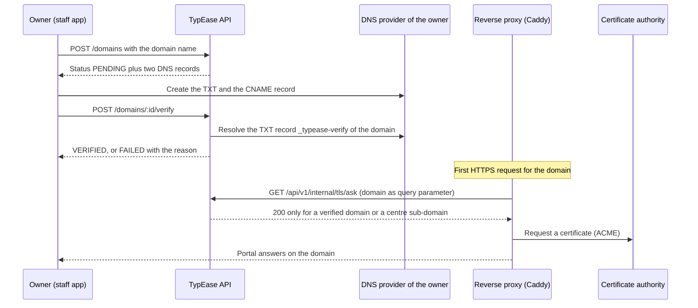

# White-label guide

What a typing centre can brand in TypEase, how the branding reaches each surface, how custom domains work,
and where the limits are. Written for centre owners, for the operator who hosts the platform, and for
engineers. It describes the code as it is; where something is stored but not acted on, it says so.

Code: `services/api/src/modules/tenancy/branding.service.ts`, `tenant-resolver.service.ts`,
`packages/branding`, `packages/ui/src/providers/branding.tsx`, `packages/ui/src/lib/tenant.ts`.
Staff app screens: **Branding** (`/branding`) and **Custom domains** (`/domains`).

## Contents

1. [Two modes](#1-two-modes)
2. [What a centre can brand](#2-what-a-centre-can-brand)
3. [Where the branding appears](#3-where-the-branding-appears)
4. [Colours and contrast](#4-colours-and-contrast)
5. [Logo and browser icon](#5-logo-and-browser-icon)
6. [Per-branch details](#6-per-branch-details)
7. [Web addresses and custom domains](#7-web-addresses-and-custom-domains)
8. [Email and notification branding](#8-email-and-notification-branding)
9. [Plan gating](#9-plan-gating)
10. [Mobile app](#10-mobile-app)
11. [API reference](#11-api-reference)
12. [Limits](#12-limits)

## 1. Two modes

Every centre is in one of two presentation modes (`branding_settings.mode`).

| Mode | What customers see |
| --- | --- |
| `TYPEASE` (default) | The TypEase logo and colours, with the centre's name, contact details and document footers. Emails and PDFs carry a "Powered by TypEase" line |
| `WHITE_LABEL` | The centre's logo, colours, website title and tagline. No "Powered by TypEase" line in emails or on PDFs |

White-label presentation is applied only when **both** hold: the centre switched the mode on, **and** its
subscription plan includes the feature `whiteLabel`. The check is made every time the public configuration is
built (`BrandingService.publicConfig`), not only when the setting is saved. A centre whose plan no longer
includes the feature is therefore presented with TypEase branding again without anything being deleted; the
stored logo and colours return when the feature does.

Switching modes loses nothing: the stored values stay in place.


## 2. What a centre can brand

All fields live in `branding_settings` (one row for the centre, optional rows per branch). The owner edits
them on the **Branding** screen; the permission is `branding.manage`, held by the owner role by default.

| Setting | Field | Mode it needs | Rules |
| --- | --- | --- | --- |
| Business name, English and Arabic | `businessName`, `businessNameAr` | Either | Up to 120 characters. Falls back to the name given at sign-up |
| Whose brand customers see | `mode` | Plan feature for `WHITE_LABEL` | Centre level only; a branch cannot have its own mode |
| Primary, secondary and accent colour | `primaryColor`, `secondaryColor`, `accentColor` | White label | Six-digit hex (`#0B7AD1`). Defaults: `#0B2240`, `#0B7AD1`, `#00A166` |
| Logo | `logoAssetKey` | White label | PNG, JPEG or WebP, at most 1 MB (section 5) |
| Browser icon (favicon) | `faviconAssetKey` | White label | Same rules as the logo |
| Website title | `websiteTitle` | White label | Up to 80 characters; shown in the browser tab. Otherwise the business name |
| Tagline | `tagline` | White label | Up to 120 characters. In TypEase mode the tagline is "Typing Made Easy." |
| Support email and phone | `supportEmail`, `supportPhone` | Either | Shown on the portal, in email footers and on PDFs. Fall back to the centre's contact details |
| Email sender name | `emailFromName` | Either | Up to 80 characters (section 8) |
| Email sender address | `emailFromAddress` | Either | Stored; see section 8 for when it is actually used |
| Invoice footer, receipt footer | `invoiceFooter`, `receiptFooter` | Either | Up to 500 characters each; printed on PDFs |
| Public service catalogue | `publicCatalogueEnabled` | Either | When off, the public catalogue endpoint answers 404 for the centre |

Saving any of the white-label fields (mode, colours, website title, tagline) or uploading a logo or favicon
without the plan feature answers `402 PLAN_LIMIT_REACHED`. The screen lets an owner prepare the values and
says that saving needs an upgrade.

Things that are **not** configurable per centre: fonts, layout, page structure, the wording of the user
interface, custom CSS or HTML, the staff application's address, the corporate portal's address, the sender
of SMS and WhatsApp messages (those come from the provider account), and the content of the mobile store
listing.

Notification wording is configurable separately: a centre can override the built-in message templates per
event, channel and language (staff app **Notification settings**; see
[api/modules/notifications.md](api/modules/notifications.md)). That is content, not branding, and is not
plan-gated by `whiteLabel`.

## 3. Where the branding appears

| Surface | What is branded | How it gets there |
| --- | --- | --- |
| Customer portal (`apps/customer-web`) | Name, logo, favicon, colours (light and dark theme), website title, tagline, support contact | The server resolves the centre for each request and inlines the theme as CSS variables, so the first paint is already branded |
| Corporate portal (`apps/corporate-portal`) | The same presentation data | Same mechanism. It is served on the shared corporate address with `?tenant=<slug>`; it has no custom domains |
| Staff app (`apps/centre-web`) | Colours and name after sign-in | The app loads the centre's public configuration once the user is signed in and remembers the centre in a cookie, so later visits from the same browser (including the sign-in page) are painted with its colours. Before the first sign-in in a browser the staff app is TypEase-branded, because the centre is not known yet |
| Platform console (`apps/platform-admin`) | Nothing | It is the operator's tool and is always TypEase-branded |
| Emails | Header in the primary colour with logo or name, support contact in the footer, sender name | `emailLayout` in `services/api/src/modules/notifications/render.ts` |
| PDF quotations, invoices, receipts, credit notes | Header band in the primary colour, accent rule, section titles in the secondary colour, name, legal name, contact, tax registration number, logo, footer text | `services/api/src/modules/finance/pdf.service.ts`, `pdf.renderer.ts` |
| Mobile app (`apps/customer-mobile`) | Name, logo, colours inside the app | Loaded from the same public configuration at start (section 10). Never compiled or run |
| Waiting-room queue display | The branch name | Public page of the staff app opened with a signed display link |
| Authenticator app entry (MFA) | The issuer name shown next to the account: the centre's business name (or centre name) when white label applies, otherwise `TypEase` | `mfaIssuer` in `services/api/src/modules/auth/auth.service.ts`, used by `POST /auth/mfa/setup`; platform staff always get `TypEase` |
| SMS, WhatsApp, push | Message text only | No visual branding. The sender identity is the provider account's |

The public configuration is a single unauthenticated endpoint, `GET /api/v1/public/tenant-config`, selected
by `slug`, by `host`, or by the host the request arrived on. It returns only presentation data: name, mode,
logo and favicon URLs, the three colours, website title, tagline, support contact, default language,
currency, time zone, whether the public catalogue is enabled, and three feature flags (self-registration,
corporate portal, whether the centre is open). It includes the centre's internal id. It never contains anything about customers or staff. Choosing a centre this way selects branding and
the public catalogue; it is never authorisation. Data access always uses the centre bound to the signed-in
session ([TENANT_ISOLATION.md](TENANT_ISOLATION.md)).

A centre whose status is archived or cancelled has no public configuration (404), and the portals show their
"centre not found" page.

## 4. Colours and contrast

A centre chooses three colours. It does not choose text colours: those are derived, so that a poor choice
cannot make the interface unreadable.

The derivation is in `packages/branding/src/theme.ts` and `color.ts` (pure functions, WCAG 2.x relative
luminance and contrast ratio). For both the light and the dark theme it guarantees:

| Pair | Minimum contrast ratio |
| --- | --- |
| Text on a brand-coloured button or badge | 4.5 : 1 |
| Brand-coloured text on the page, card, muted and tinted surfaces | 4.5 : 1 |
| Sidebar text on the sidebar, and on the active menu item | 4.5 : 1 |
| Focus ring against the page | 3 : 1 |
| Input borders against page and card | 3 : 1 |

How it achieves that:

- **Text on a fill** is white when white reaches 4.5 : 1; otherwise the fill is darkened slightly if that is
  enough; otherwise near-black text is used.
- **A colour used as text** is moved in lightness (keeping its hue) by the smallest amount that reaches the
  ratio on every surface it is used on.
- **A fill too close to the page background** is strengthened so that buttons stay visible.
- **A secondary colour too close to the primary** would make the active menu item vanish; a neutral
  highlight is used instead.

So a colour is **adjusted, never rejected**: the API accepts any six-digit hex value, and the screens may
show a slightly different shade than the one typed. The Branding screen tells the owner when that happens
("buttons use a slightly stronger shade so they stay visible") and shows a live preview in both themes.
An invalid or missing colour falls back to the TypEase colour.

Verification: `packages/branding/src/color.test.ts` and `theme.test.ts` check the pairs above for the
TypEase palette, for a set of named difficult palettes and for 300 arbitrary colour triples
(`pnpm test:unit`). This is a computed check of colour pairs. It is not an accessibility audit of the
applications, and none has been carried out.

**Where the guarantee does not apply.** The email header and the PDF header band print white text directly
on the centre's primary colour without adjusting it. A light primary colour gives a poorly readable name in
emails and on invoices even though the portal stays readable. Check an email and a PDF after changing the
primary colour.

## 5. Logo and browser icon

| Rule | Value |
| --- | --- |
| Accepted types | PNG, JPEG, WebP. The type is detected from the first bytes of the file, not from its name or declared type |
| Maximum size | 1 MB |
| SVG | Not accepted |
| Storage key | 24 random bytes plus the extension. Never derived from the file name |
| Where it is stored | Local driver: `<STORAGE_LOCAL_DIR>/public-assets`. S3 driver: the bucket `S3_PUBLIC_ASSETS_BUCKET` |
| How it is served | `GET /api/v1/public/assets/<key>` with a one-year immutable cache header and `X-Content-Type-Options: nosniff`, or from `S3_PUBLIC_ASSETS_BASE_URL` when the operator configured a public bucket or CDN address |
| Processing | None. The image is not resized, re-encoded or stripped of metadata |

Logos and favicons are **public** files by design: anybody who has the URL can fetch them. They are kept
apart from the private document store, which is never public. Replacing a logo stores a new file under a new
key; the old file is not deleted.

On PDFs only PNG and JPEG logos are embedded (the PDF library does not embed WebP); with a WebP logo the
centre's name is printed instead. In emails the logo is referenced by URL, so recipients whose mail client
blocks remote images see the alternative text (the centre's name).

Uploading needs the plan feature even before white-label mode is switched on.

## 6. Per-branch details

A branch can have its own branding row. Empty fields fall back to the centre's value. The Branding screen
offers name, contact details and footers per branch; the API (`PUT /branding/branches/:branchId`) accepts
the same fields as the centre-level call except `mode`.

Branch values are used where a branch is known: `GET /public/tenant-config?branchId=` and PDFs of documents
that belong to a branch (the footer and, in white-label mode, the logo). The customer portal as a whole is
presented with the centre-level values. Emails use the centre-level sender.

## 7. Web addresses and custom domains

### 7.1 Addresses a centre has

| Address | Example | Plan feature | Notes |
| --- | --- | --- | --- |
| Shared customer portal with the centre selected by query | `https://portal.<base>/?tenant=al-noor` | None | The slug is remembered in a cookie (`te_tenant`) |
| The centre's own TypEase sub-domain | `https://al-noor.<base>` | None | `<slug>.<PLATFORM_BASE_DOMAIN>`. Exists automatically for every centre |
| Custom domain | `https://portal.yourcentre.example` | `customDomains` | Verified by DNS. **Serves the customer portal only** |
| Staff app | `https://app.<base>` | None | One address for all centres; the centre comes from the signed-in session |
| Corporate portal | `https://corporate.<base>/?tenant=al-noor` | `corporatePortal` to use the portal | Shared address only |

The slug is chosen at sign-up, is unique, and cannot be a reserved name (`www`, `api`, `app`, `admin`,
`portal`, `corporate`, `support`, `mail`, `s3`, `n8n`, `grafana` and others in `RESERVED_SLUGS`).

How a portal request finds its centre (`packages/ui/src/lib/tenant.ts`), in order:

1. the host, when it is not the shared portal host: a verified custom domain or `<slug>.<base>`;
2. `?tenant=<slug>` in the URL, then the cookie that remembers it;
3. `NEXT_PUBLIC_DEFAULT_TENANT_SLUG`, for single-centre deployments and local development;
4. otherwise the "centre not found" page.

### 7.2 Connecting a custom domain

Permission `domain.manage` (owner). Screen: **Custom domains**.



The two records:

| Type | Name | Value | Purpose |
| --- | --- | --- | --- |
| TXT | `_typease-verify.<domain>` | `typease-verify=<token>` | Proves control of the domain. The token is random and specific to this centre and domain |
| CNAME | `<domain>` | The value of `CUSTOM_DOMAIN_CNAME_TARGET` (the shared portal host) | Sends visitors to the platform |

Rules enforced by the API:

- The domain must look like a host name, must not be the platform's base domain or a sub-domain of it
  (`400 DOMAIN_NOT_ALLOWED`), and can be claimed by one centre only (`409 DOMAIN_IN_USE`; the answer never
  says which centre holds it). An unverified claim blocks the domain for **72 hours** only: after that
  another centre's claim replaces it (the first centre's audit trail records `domain.claim_released` without
  naming the other centre, and the old TXT value proves nothing any more). Unverified claims older than 14
  days are removed by the daily job `tenancy.domain_claims_cleanup`. A verified domain is never released
  automatically; only the operator can release it (`DELETE /platform/domains/:id`, reason required, audited
  on the platform trail and on the centre's trail).
- Verification looks **only at the TXT record**. The CNAME is not checked; without it the domain is verified
  but visitors do not arrive.
- A failed check says what was wrong: the record was not found yet, or was found with a different value.
  Nothing breaks; the owner tries again later.
- The verification state is written with the system database role; the tenant-scoped role has no permission
  to set a domain to verified.
- The first verified domain of a centre becomes its **primary** domain. Links in notifications (request
  links, quotation and payment links, renewal links) then use `https://<primary domain>` instead of the
  shared portal address with `?tenant=`.
- Removing a domain takes effect at once (the resolver cache is cleared; other API instances follow within
  30 seconds).
- Statuses: `PENDING`, `VERIFIED`, `FAILED`, `DISABLED`. A centre's domains are set to `DISABLED` when the
  platform offboards the centre. A verified domain of a centre whose plan no longer includes custom domains
  is shown as `SUSPENDED_BY_PLAN` (the stored status stays `VERIFIED`); the response also carries `routed`
  (true only while the portal is reachable on the domain) and, for unverified claims, `claim.releasableAt`
  and `claim.expiresAt`.


### 7.3 TLS

Certificates are **not** issued by the application. The production reverse proxy configuration
(`infrastructure/docker/caddy/Caddyfile.prod`) uses Caddy's on-demand TLS: before requesting a certificate
for a host it has never seen, the proxy asks the API (`/api/v1/internal/tls/ask`), and the API answers 200
only for a centre sub-domain or a verified custom domain. This prevents the proxy from requesting
certificates for arbitrary host names pointed at it. The `internal` path is refused on every public host by
the proxy.

On tenant hosts the proxy also serves `/api/v1/*`, so that the portal calls the API on its own origin. This
is required: the refresh cookie is `SameSite=Lax`, and a browser would not send it from a centre's domain to
the platform's API host.

The operator can use a wildcard certificate for centre sub-domains instead (see
[deployment/reverse-proxy-and-tls.md](deployment/reverse-proxy-and-tls.md)). Custom domains always need
on-demand issuance or certificates supplied in some other way.

**Status of verification.** The API side (DNS check with a substitutable resolver, the "ask" endpoint, host
resolution, CORS for verified domains) is covered by the tenancy tests. The proxy configuration was checked
statically only. No certificate has been issued, and no custom domain has been served end to end, in the
environment this was built in. Treat the first real domain as a test.

### 7.4 CORS and sessions on a custom domain

Origins the API accepts: the four configured application URLs, `CORS_ORIGINS`, and any host that resolves to
a centre (sub-domain or verified custom domain). A session started on one portal host is not valid on
another host, because the refresh cookie belongs to the host it was set on; a customer who moves from the
shared portal to the custom domain signs in again.

## 8. Email and notification branding

| Element | Source | Notes |
| --- | --- | --- |
| Header | Primary colour; the logo in white-label mode, otherwise the centre's name | No contrast adjustment (section 4) |
| Body | The template for the event, channel and language (built in, or the centre's override) | Arabic messages are laid out right to left |
| Footer | A fixed security note, the support contact, "This message was sent by <name>" | "Powered by TypEase" is added unless the centre is in white-label mode |
| From name | `emailFromName`, else the name configured on the centre's own SMTP connection, else the centre's name | Applies in both modes |
| From address | See below | |
| Reply-To | The centre's support email | |

**From address.** The code uses, in this order:

1. the `fromAddress` configured on the centre's **own SMTP connection** (staff app **Integrations**, category
   Email), when the centre has one and it is switched on;
2. the centre's `emailFromAddress`, but only when `emailSenderVerified` is true;
3. the platform's `MAIL_FROM_ADDRESS`.

`emailSenderVerified` is reset to false whenever the address changes, and **no code path sets it to true**:
there is no sender-verification flow (no DNS check for SPF or DKIM, no confirmation with an email provider).
In practice, therefore, a centre's emails are sent from the platform address with the centre's sender name,
unless the centre connects its own mail server. The Branding screen says "Sender address not verified yet"
for that reason. Deliverability of mail sent from a centre's own domain (SPF, DKIM, DMARC) is the
responsibility of whoever runs that mail server.

SMS, WhatsApp and push messages carry no branding beyond their text. The sender number, the WhatsApp
business profile and the push sender are properties of the provider account, either the platform's or the
centre's own connection. None of the providers has been exercised against the real service.

## 9. Plan gating

Default plans as created by provisioning (`DEFAULT_PLANS` in `provisioning.service.ts`); the operator can
change plans in the platform console.

| Plan | `whiteLabel` | `customDomains` |
| --- | --- | --- |
| Starter | No | No |
| Professional | No | No |
| Business | Yes | Yes |
| Enterprise | Yes | Yes |

| Action without the feature | Result |
| --- | --- |
| Switch to white label, save colours, title or tagline, upload logo or favicon | `402 PLAN_LIMIT_REACHED`; the screen links to the subscription page |
| Add a custom domain | `402 PLAN_LIMIT_REACHED` |
| Read the settings | Allowed. The response says whether the feature is included (`whiteLabelIncluded`, `customDomainsIncluded`) |

After a downgrade:

- white-label presentation stops immediately, because it is evaluated on every read;
- **custom domains stop resolving.** The resolver checks the plan feature on every lookup: the host no longer
  maps to the centre (`404` from the public configuration, `404` from `tls/ask`, no CORS), the domain is
  listed as `SUSPENDED_BY_PLAN`, and notification links fall back to the centre's TypEase address. The row is
  kept and stays exclusive to the centre; when the plan includes the feature again the domain resolves
  without a new verification.

## 10. Mobile app

The Flutter customer app (`apps/customer-mobile`) is source code only. **It has never been compiled or run**;
everything in this section describes what the code is written to do.

There are two ways to give a centre a branded mobile experience. Full detail and the checklist are in
[apps/customer-mobile/WHITE_LABEL_MOBILE.md](../apps/customer-mobile/WHITE_LABEL_MOBILE.md).

| | Shared app, branded at run time | Separately published app |
| --- | --- | --- |
| What the customer installs | One "TypEase" app | An app under the centre's name |
| Inside the app | The centre's name, logo and colours, loaded from `GET /public/tenant-config` | The same |
| Choosing the centre | Once, by link, QR code or centre code | Never; the build is locked with `TENANT_SLUG` |
| Icon, name under the icon, store listing, splash image | TypEase's | The centre's |
| Per-centre effort | Configuration only | A separate build, signing identity, store account and review for every release |

Build procedure for a separately published app, in summary:

1. Decide the application id and bundle id. They are permanent.
2. Generate the platform folders with `tool/bootstrap.sh` (`ORG`, `APP_NAME`, `DEEP_LINK_SCHEME`,
   `DEEP_LINK_HOSTS`), in a separate checkout or copy per app.
3. Replace icons and launch screen; configure signing (an Android upload keystore, an Apple distribution
   certificate and profile). Signing material is never committed.
4. Create the push configuration for the new ids.
5. Publish the link-association files on the centre's portal host.
6. Build with `--dart-define` values: `API_BASE_URL`, `TENANT_SLUG`, optionally `TENANT_HOST`,
   `PORTAL_BASE_URL`, `DEEP_LINK_SCHEME`, `DEEP_LINK_HOSTS`, and the `FIREBASE_*` values.
7. Submit under the centre's own store accounts, and repeat the build and review for every later release.

Android product flavors and iOS schemes are not set up in the repository. The API does not treat the two
modes differently for the mobile app, and whether a centre is entitled to its own published app is a
commercial decision that no code enforces. The staff app's Branding screen states that a separately
published app "is a project with TypEase, not a setting on this page".

## 11. API reference

All under `/api/v1`. The tenancy module has no module reference document; the controller is
`services/api/src/modules/tenancy/tenancy.controller.ts`.

| Method | Path | Access | Purpose |
| --- | --- | --- | --- |
| GET | `/public/tenant-config?slug=` or `?host=` or by request host, optional `branchId` | Public | Presentation data of a centre |
| GET | `/public/assets/:key` | Public | A logo or favicon |
| GET | `/branding` | `branding.manage` or `settings.manage` | Centre row, branch rows, `whiteLabelIncluded`, default colours |
| PUT | `/branding` | `branding.manage` | Update the centre's branding |
| PUT | `/branding/branches/:branchId` | `branding.manage` | Branch override |
| POST | `/branding/logo`, `/branding/favicon` | `branding.manage` | Multipart upload, part `file` |
| GET | `/domains` | `domain.manage` | The TypEase address, `customDomainsIncluded`, the domains with DNS instructions for unverified ones |
| POST | `/domains` | `domain.manage` | `{ domain }`; returns the DNS records |
| POST | `/domains/:id/verify` | `domain.manage` | Check the TXT record |
| DELETE | `/domains/:id` | `domain.manage` | Remove the domain |
| GET | `/platform/domains` | Platform: `platform.tenants.read` | Domain claims of all centres (who holds a domain) |
| DELETE | `/platform/domains/:id` | Platform: `platform.tenants.manage` | Release a claim of any centre, verified or not; `{ reason }` required |
| GET | `/internal/tls/ask?domain=` | Reverse proxy only (blocked on public hosts by the proxy) | 200 or 404 |

Every change writes an audit entry: `branding.updated`, `domain.added`, `domain.verified`,
`domain.verification_failed`, `domain.removed`, `domain.claim_released` (system), `domain.released_by_platform`.

Example, shortened (centre `docs-example` is a throw-away centre in the development database):

```bash
curl -s "http://localhost:4000/api/v1/public/tenant-config?slug=docs-example"
```

```json
{
  "tenantId": "dad0633f-...",
  "slug": "docs-example",
  "name": "Docs Example Typing (fictional)",
  "nameAr": null,
  "mode": "TYPEASE",
  "logoUrl": null,
  "faviconUrl": null,
  "colors": { "primary": "#0B2240", "secondary": "#0B7AD1", "accent": "#00A166" },
  "websiteTitle": "Docs Example Typing (fictional)",
  "tagline": "Typing Made Easy.",
  "supportEmail": "owner@docs-example.test",
  "supportPhone": "+971590008877",
  "defaultLanguage": "en",
  "currency": "AED",
  "timezone": "Asia/Dubai",
  "publicCatalogueEnabled": true,
  "features": { "selfRegistration": true, "corporatePortal": false, "open": false }
}
```

## 12. Limits

Stated plainly so that nobody assumes otherwise.

| Area | Limit |
| --- | --- |
| Custom domains | Customer portal only. The staff app and the corporate portal have no custom domains (`domainSchema` accepts `app: "customer"` only) |
| Domain verification | TXT record only; the CNAME is not checked. A verified domain is not re-checked later: it stays verified after the DNS record is removed |
| Primary domain | The first verified domain. There is no action to choose a different primary |
| Claimed domains | An unverified claim blocks the domain for other centres for 72 hours, then it can be taken over; a verified domain is exclusive until the centre removes it or the operator releases it (`DELETE /platform/domains/:id`; the platform console lists a centre's domains but has no button for this call) |
| Downgrade | Verified domains stop resolving while the plan lacks `customDomains` (`SUSPENDED_BY_PLAN`) and resume when it is restored; the owner is not notified of the suspension |
| TLS | Issued by the reverse proxy, not the application. Not exercised in the build environment |
| Sender address | No verification flow. A centre's own from-address is used only through its own SMTP connection |
| Email and PDF headers | No contrast adjustment of the primary colour |
| PDFs | English, Latin-1 characters only: Arabic names and footers print as `?`. WebP logos are not embedded |
| Logos | No resizing or optimisation; no SVG; old files are not deleted |
| Staff app | TypEase-branded until somebody has signed in from that browser; it has one address for all centres |
| Theming | Three colours. No custom fonts, CSS, layout or wording of the interface |
| Mobile | Source only, never compiled. Icon, app name and store listing cannot be branded without a separate published build |
| Accessibility | Colour-pair contrast is computed and tested; no accessibility audit of the applications has been done |
| Messaging providers | SMTP was exercised against a local test server; SMS, WhatsApp and push only against local fakes |

Related documents: [ARCHITECTURE.md](ARCHITECTURE.md), [DEPLOYMENT_GUIDE.md](DEPLOYMENT_GUIDE.md),
[deployment/reverse-proxy-and-tls.md](deployment/reverse-proxy-and-tls.md),
[user-guides/OWNER_USER_GUIDE.md](user-guides/OWNER_USER_GUIDE.md).
