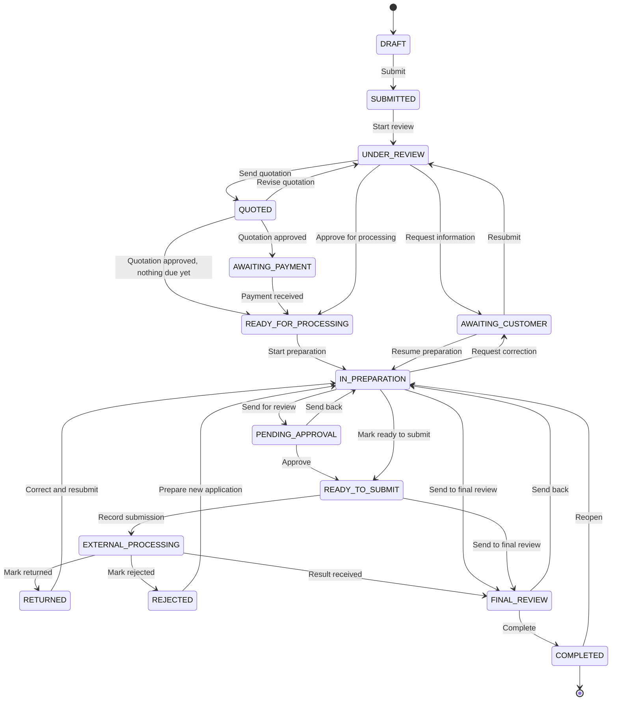
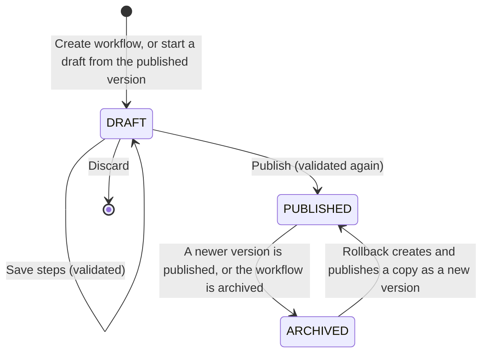
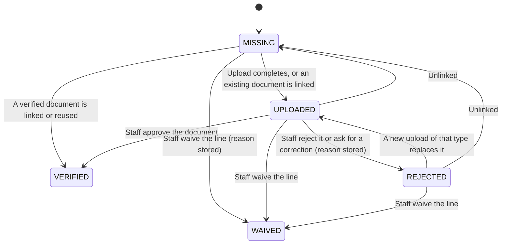
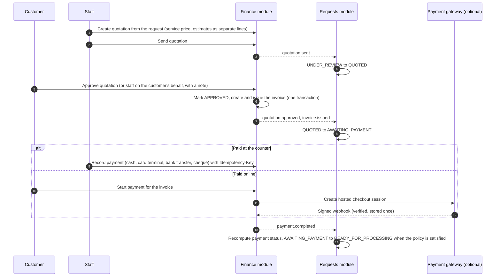
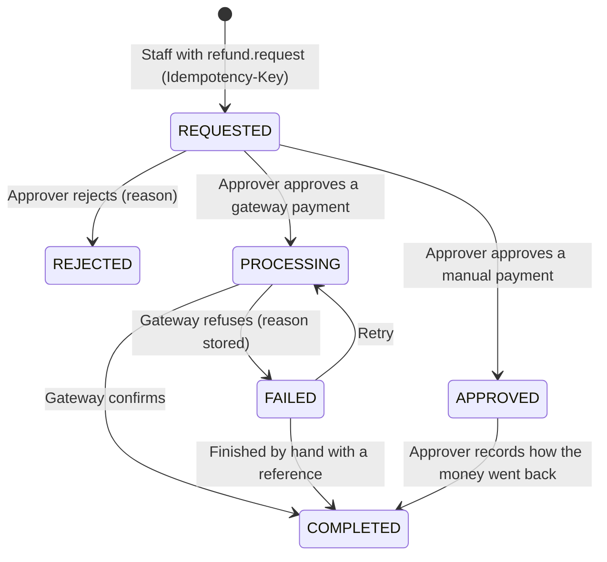
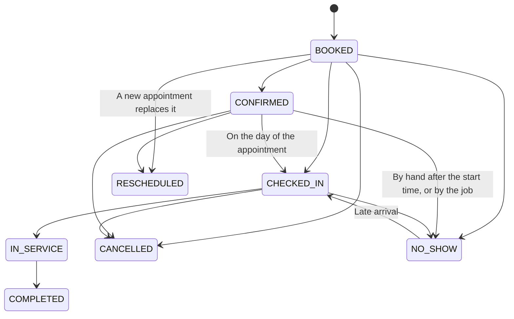
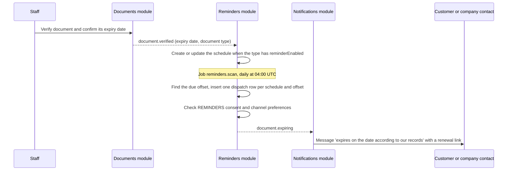
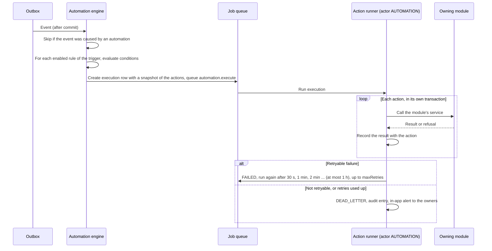

# Workflow documentation

How work moves through TypEase: the life of a service request, the workflow a centre configures around it,
and the processes that surround it (forms, documents, money, appointments, reminders, automations and the
recording of submissions made outside the system).

This document describes what the code does at the time of writing. It is a guide to behaviour; the exact
request and response shapes are in the module references under [api/modules/](api/modules/), and the
generated, test-guarded transition table and engine description are in
[workflows/REQUEST_LIFECYCLE.md](workflows/REQUEST_LIFECYCLE.md). Where the two overlap, this document
summarises and links instead of repeating.

## Contents

1. [Two layers: state machine and workflow](#1-two-layers-state-machine-and-workflow)
2. [Request statuses and transitions](#2-request-statuses-and-transitions)
3. [Workflow builder](#3-workflow-builder)
4. [Dynamic forms](#4-dynamic-forms)
5. [Document checklist](#5-document-checklist)
6. [Review and corrections](#6-review-and-corrections)
7. [Quotation, invoice, payment, refund](#7-quotation-invoice-payment-refund)
8. [Assignment](#8-assignment)
9. [Completion and delivery](#9-completion-and-delivery)
10. [Appointments and the walk-in queue](#10-appointments-and-the-walk-in-queue)
11. [Reminders and document expiry](#11-reminders-and-document-expiry)
12. [Automation engine](#12-automation-engine)
13. [Submission channels and the government-integration policy](#13-submission-channels-and-the-government-integration-policy)
14. [Background jobs at a glance](#14-background-jobs-at-a-glance)
15. [Where this is tested, and what is not](#15-where-this-is-tested-and-what-is-not)

## 1. Two layers: state machine and workflow

| Layer | Decides | Changeable by a centre | Code |
| --- | --- | --- | --- |
| Request state machine | Whether a request may go from one status to another, for this actor, now | No. It is a table in code | `packages/types/src/requests.ts`, `services/api/src/modules/requests/request-state-machine.service.ts`, `request-guards.service.ts` |
| Workflow engine | Which step is next, who has to act, when a step is finished or overdue | Yes, through the workflow builder | `services/api/src/modules/requests/workflow-engine.service.ts`, `services/api/src/modules/workflows/` |

The engine does not own a status. It asks the state machine for a transition like any other caller and can be
refused. A centre can therefore arrange its steps freely, but it cannot configure away a permission, a
required review, a payment rule or a restriction on submission. The reasoning and the test that demonstrates
it are in [REQUEST_LIFECYCLE.md, section 7](workflows/REQUEST_LIFECYCLE.md#7-compliance-can-not-be-configured-away).

## 2. Request statuses and transitions

### 2.1 Statuses

There are 16 statuses. Staff and customers see different wording (`REQUEST_STATUS_META`); the Arabic wording
is in the same table in code.

| Status | Staff wording | Customer wording | Meaning |
| --- | --- | --- | --- |
| `DRAFT` | Draft | Draft - not submitted yet | Created, form and documents may be incomplete. Does not count against the plan limit |
| `SUBMITTED` | New | Submitted | Handed to the centre. A tracking code is issued, the workflow execution starts |
| `UNDER_REVIEW` | Documents under review | Documents under review | Staff check the input documents; a quotation is prepared |
| `AWAITING_CUSTOMER` | Awaiting customer | Action needed from you | The centre asked for information or a corrected document. Nothing moves until the customer answers |
| `QUOTED` | Quotation sent | Quotation ready for approval | A quotation is with the customer |
| `AWAITING_PAYMENT` | Awaiting payment | Payment required | The quotation is approved, the invoice is issued, the payment policy is not satisfied yet |
| `READY_FOR_PROCESSING` | Ready for processing | Queued for processing | Documents verified and payment policy satisfied; waiting for an operator to start |
| `IN_PREPARATION` | In preparation | Being prepared | An operator is preparing the application |
| `PENDING_APPROVAL` | Pending review approval | Being prepared | Waiting for the internal reviewer. Customers cannot tell this status from `IN_PREPARATION` |
| `READY_TO_SUBMIT` | Ready to submit | Ready for submission | Prepared (and reviewed where required); a submission can be recorded |
| `EXTERNAL_PROCESSING` | External processing | Submitted - in processing | Staff recorded that the application was submitted outside TypEase |
| `RETURNED` | Returned | Returned for correction | Staff recorded that the authority or partner returned the application |
| `REJECTED` | Rejected | Application was not accepted | Staff recorded a rejection by the authority or partner |
| `FINAL_REVIEW` | Final review | Final checks | Last check before the case is closed |
| `COMPLETED` | Completed | Completed | Terminal. May be reopened by owner or manager |
| `CANCELLED` | Cancelled | Cancelled | Terminal. Cannot be revived |

### 2.2 Overview diagram

The diagram shows the usual path and the loops back. The complete diagram with all 45 edges is generated from
the code table in [REQUEST_LIFECYCLE.md, section 2](workflows/REQUEST_LIFECYCLE.md#2-the-transition-table).

`CANCELLED` is reachable from every status except `FINAL_REVIEW`, `COMPLETED` and `CANCELLED` itself, and is
left out of the diagram for readability.

### 2.3 Every transition and who may trigger it

The table lists all 45 edges of `REQUEST_TRANSITIONS`. "Default staff roles" is derived from the permissions
of the edge and the six built-in staff roles in `packages/permissions`; a centre's custom roles qualify
through the same permissions (the permission keys per edge are in
[REQUEST_LIFECYCLE.md](workflows/REQUEST_LIFECYCLE.md#2-the-transition-table), the roles in
[ROLE_PERMISSION_MATRIX.md](ROLE_PERMISSION_MATRIX.md)). The accountant role holds none of these permissions.

| From | To | Button label | Default staff roles | Customer | System | Reason |
| --- | --- | --- | --- | --- | --- | --- |
| `DRAFT` | `SUBMITTED` | Submit | owner, manager, receptionist, operator | yes | - | - |
| `DRAFT` | `CANCELLED` | Cancel request | owner, manager | yes | - | required |
| `SUBMITTED` | `UNDER_REVIEW` | Start review | owner, manager, receptionist, operator, reviewer | - | yes | - |
| `SUBMITTED` | `AWAITING_CUSTOMER` | Request information | owner, manager, receptionist, operator, reviewer | - | - | required |
| `SUBMITTED` | `CANCELLED` | Cancel request | owner, manager | yes | - | required |
| `AWAITING_CUSTOMER` | `UNDER_REVIEW` | Resubmit | owner, manager, receptionist, operator, reviewer | yes | yes | - |
| `AWAITING_CUSTOMER` | `IN_PREPARATION` | Resume preparation | owner, manager, operator | - | yes | - |
| `AWAITING_CUSTOMER` | `CANCELLED` | Cancel request | owner, manager | yes | - | required |
| `UNDER_REVIEW` | `AWAITING_CUSTOMER` | Request information | owner, manager, operator, reviewer | - | - | required |
| `UNDER_REVIEW` | `QUOTED` | Send quotation | owner, manager, receptionist | - | yes | - |
| `UNDER_REVIEW` | `READY_FOR_PROCESSING` | Approve for processing | owner, manager, operator, reviewer | - | yes | - |
| `UNDER_REVIEW` | `CANCELLED` | Cancel request | owner, manager | yes | - | required |
| `QUOTED` | `AWAITING_PAYMENT` | Quotation approved | - | - | yes | - |
| `QUOTED` | `READY_FOR_PROCESSING` | Quotation approved | - | - | yes | - |
| `QUOTED` | `UNDER_REVIEW` | Revise quotation | owner, manager, receptionist | - | yes | - |
| `QUOTED` | `CANCELLED` | Cancel request | owner, manager | yes | - | required |
| `AWAITING_PAYMENT` | `READY_FOR_PROCESSING` | Payment received | - | - | yes | - |
| `AWAITING_PAYMENT` | `QUOTED` | Revise quotation | owner, manager, receptionist | - | yes | - |
| `AWAITING_PAYMENT` | `CANCELLED` | Cancel request | owner, manager | yes | - | required |
| `READY_FOR_PROCESSING` | `IN_PREPARATION` | Start preparation | owner, manager, operator | - | - | - |
| `READY_FOR_PROCESSING` | `CANCELLED` | Cancel request | owner, manager | - | - | required |
| `IN_PREPARATION` | `PENDING_APPROVAL` | Send for review | owner, manager, operator | - | - | - |
| `IN_PREPARATION` | `READY_TO_SUBMIT` | Mark ready to submit | owner, manager, operator | - | - | - |
| `IN_PREPARATION` | `FINAL_REVIEW` | Send to final review | owner, manager, operator | - | - | - |
| `IN_PREPARATION` | `AWAITING_CUSTOMER` | Request correction | owner, manager, operator | - | - | required |
| `IN_PREPARATION` | `CANCELLED` | Cancel request | owner, manager | - | - | required |
| `PENDING_APPROVAL` | `READY_TO_SUBMIT` | Approve | owner, manager, reviewer | - | - | - |
| `PENDING_APPROVAL` | `IN_PREPARATION` | Send back | owner, manager, reviewer | - | - | required |
| `PENDING_APPROVAL` | `CANCELLED` | Cancel request | owner, manager | - | - | required |
| `READY_TO_SUBMIT` | `EXTERNAL_PROCESSING` | Record submission | owner, manager, operator | - | - | - |
| `READY_TO_SUBMIT` | `FINAL_REVIEW` | Send to final review | owner, manager, operator | - | - | - |
| `READY_TO_SUBMIT` | `IN_PREPARATION` | Back to preparation | owner, manager, operator, reviewer | - | - | required |
| `READY_TO_SUBMIT` | `CANCELLED` | Cancel request | owner, manager | - | - | required |
| `EXTERNAL_PROCESSING` | `FINAL_REVIEW` | Result received | owner, manager, operator | - | - | - |
| `EXTERNAL_PROCESSING` | `RETURNED` | Mark returned | owner, manager, operator | - | - | required |
| `EXTERNAL_PROCESSING` | `REJECTED` | Mark rejected | owner, manager, operator | - | - | required |
| `EXTERNAL_PROCESSING` | `CANCELLED` | Cancel request | owner, manager | - | - | required |
| `RETURNED` | `IN_PREPARATION` | Correct and resubmit | owner, manager, operator | - | - | - |
| `RETURNED` | `AWAITING_CUSTOMER` | Request correction | owner, manager, operator | - | - | required |
| `RETURNED` | `CANCELLED` | Cancel request | owner, manager | - | - | required |
| `REJECTED` | `IN_PREPARATION` | Prepare new application | owner, manager, operator | - | - | required |
| `REJECTED` | `CANCELLED` | Cancel request | owner, manager | - | - | required |
| `FINAL_REVIEW` | `COMPLETED` | Complete | owner, manager, reviewer | - | - | - |
| `FINAL_REVIEW` | `IN_PREPARATION` | Send back | owner, manager, operator, reviewer | - | - | required |
| `COMPLETED` | `IN_PREPARATION` | Reopen | owner, manager | - | - | required |

How to read it:

- **Default staff roles** `-` means no person can trigger the edge by hand; it only happens as a reaction
  to an event (quotation approved, payment received).
- **Customer** means the owning customer, or the administrator of the company the request is billed to, on
  their own request. Customers can cancel up to and including `AWAITING_PAYMENT`; afterwards cancelling is
  for staff with `request.cancel` (403 `CANCELLATION_NOT_ALLOWED` otherwise).
- **System** means the edge may be used without a person deciding: by the "resubmit" bookkeeping, by a job
  running as the system, and by an automation rule (section 12). The workflow engine may use any edge of the
  table for the step it is executing.
- **Reason required**: the caller must give a reason; it is stored in the append-only history. Reasons are
  internal; the customer sees the customer wording of the new status or the message staff wrote for them.

A pair that is not in the table is refused with 409 `INVALID_TRANSITION` for every actor. Being in the table
is necessary but not sufficient: each edge also has **guards** that look only at the facts of the request
(documents verified, quotation approved, payment policy satisfied, operator assigned, review approved by
somebody other than the operator, a permitted submission recorded, completion documents attached, zero
balance). The guard table with its error codes is in
[REQUEST_LIFECYCLE.md, section 4](workflows/REQUEST_LIFECYCLE.md#4-guards).

Every change goes through one function (`RequestStateMachine.transition`): row lock, edge, authority,
optional optimistic `version`, reason, guards, write, history row, audit entry, events, workflow hook - all
in one database transaction. Details: [REQUEST_LIFECYCLE.md, section 3](workflows/REQUEST_LIFECYCLE.md#3-one-transition-step-by-step).

### 2.4 What is frozen when a request is created

Creating a request (`POST /requests`) copies the rules that apply to it, so later changes to the catalogue do
not change running cases:

- `serviceSnapshot`: name, code, compliance capability, `requiresApproval`, payment policy, deposit percent,
  tax mode, estimated processing hours, category key;
- the published form version of the service;
- the published version of the service's workflow, or of the centre's default workflow;
- the checklist, built from the service's document requirements.

## 3. Workflow builder

Module reference: [api/modules/workflows.md](api/modules/workflows.md). Staff app screen: **Workflows**
(`apps/centre-web/app/(app)/workflows`). Permission: `workflow.manage` (owner and manager by default).

### 3.1 Definitions, versions, steps

| Concept | Table | Rules |
| --- | --- | --- |
| Definition | `workflow_definitions` | A named workflow of one centre with a `key` unique per centre |
| Version | `workflow_versions` | `DRAFT`, `PUBLISHED` or `ARCHIVED`. At most one published version per definition (database index) and at most one draft (API rule). Published and archived versions are never edited |
| Step | `workflow_steps` | Ordered steps of a version. Position 1..n is assigned by the server from the order of the array |
| Execution | `workflow_executions`, `workflow_step_executions` | One execution per submitted request, pinned to a version id. Each entry into a step is a row with an attempt number; this is the execution history |

### 3.2 Step types

| Type | Waits for | What the engine does |
| --- | --- | --- |
| `CUSTOMER_FORM` | The form validates | Nothing else |
| `DOCUMENT_UPLOAD` | Every mandatory input line has a document or is waived | Nothing else |
| `STAFF_VERIFICATION` | Every mandatory input line verified or waived, none rejected | Moves `SUBMITTED` to `UNDER_REVIEW`; sends the request to `AWAITING_CUSTOMER` naming the rejected documents |
| `QUOTATION` | A quotation is sent | Creates the task "Prepare quotation"; then `UNDER_REVIEW` to `QUOTED` |
| `CUSTOMER_APPROVAL` | The quotation is approved | On rejection, expiry or withdrawal returns to the quotation step |
| `PAYMENT` | The payment policy is satisfied | Before processing: `QUOTED` to `AWAITING_PAYMENT`, then releases the request. Skipped when nothing is due yet or corporate credit applies |
| `STAFF_TASK` | Staff move the request on, or mark "preparation done" | Releases the request to `READY_FOR_PROCESSING` and creates the operator's task |
| `INTERNAL_APPROVAL` | The review is approved | `IN_PREPARATION` to `PENDING_APPROVAL`, task for the reviewer. Rejected: back to the preparation step |
| `EXTERNAL_PROCESSING` | The result "completed" is recorded on the submission | Task "Submit application and record the reference". Skipped for services the centre may not submit |
| `NOTIFICATION` | Nothing | Writes a history note with `config.message` and emits an informational status event |
| `DOCUMENT_GENERATION` | The file is stored | Builds a request summary PDF and files it with the request |
| `CONDITIONAL_BRANCH` | Nothing | Evaluates `branches` in order; first match decides the next step |
| `COMPLETION` | The request is completed | Moves the request to `FINAL_REVIEW`, task "Final review" for the reviewer |

A step can carry: `conditions` (the step is skipped when false), `nextStepKey`, `onRejectStepKey` (approval
steps only), `assigneeRoleKey`, `timeoutHours` (1 to 2160), `escalateToRoleKey` and `customerVisible`.

### 3.3 Rules (conditions and branches)

`{ all?: Condition[], any?: Condition[] }` with `Condition = { fact, op, value }`. Operators: `eq`, `neq`,
`in`, `nin`, `gt`, `gte`, `lt`, `lte`, `exists`, `truthy`. Facts available to a workflow (`WORKFLOW_FACTS`):
`service.code`, `service.categoryKey`, `service.requiresApproval`, `service.complianceCapability`,
`service.paymentPolicy`, `branch.code`, `customer.type`, `customer.isCorporate`, `request.priority`,
`request.source`, `documents.complete`, `payment.status`, `quotation.total`, `assignee.roleKey`,
`approval.result`. The evaluator is a pure function (`rule-evaluator.ts`); there is no scripting and no
expression language beyond this.

### 3.4 Templates

Three templates are defined in code (`workflow-templates.ts`) and copied into every centre when it is
provisioned, each as a definition with a published version 1. After that the centre owns its copies.

| Key | Steps | Intended use |
| --- | --- | --- |
| `standard` (centre default) | form, documents, verification, quotation, customer approval, payment, prepare, review (only if the service requires approval), submission (only if the capability is `PARTNER_COORDINATION` or `DIRECT_AUTHORISED`), completion | Most services |
| `walk-in-express` | documents, verification, quotation, customer approval, payment, task "Type / print the document", completion; time limits of 2 to 4 hours | Typing and printing while the customer waits |
| `pay-on-completion` | As `standard`, with the payment step directly before completion | Services whose payment policy is "after completion" or "deposit" |

### 3.5 Publishing rules

- **Validation** runs when a workflow is created, when a draft is saved, when it is published and when a
  version is rolled back to. The validator (`validateWorkflow`, pure and unit-tested) requires, among other
  things: exactly one Completion step, last and unconditional; every step reachable and every path ending at
  Completion; the default flow only moving forward; a Quotation before Customer approval and before Payment;
  a Staff task before External processing, Internal approval and Completion; roles that exist in the centre;
  known facts and well-formed rules. All problems are returned together (422 `WORKFLOW_INVALID`).
  `POST /workflows/validate` is a dry run.
- **Publishing** archives the previously published version. Requests already running keep the version they
  started with; new requests use the new version.
- **Rollback** does not move a pointer: it creates version N+1 as a copy of the chosen version and publishes it.
- **Archiving** a workflow is refused while a service uses it (409 `WORKFLOW_IN_USE`) or while it is the
  centre default (409 `DEFAULT_WORKFLOW`). Cases already running on it continue.
- **Deleting** (`DELETE /workflows/:id`) is possible only for a workflow that has no published version and
  was never used by a service or a request. Anything that was ever in use is archived, not deleted.
- **Migration** of a running case to the newly published version is explicit and per case
  (`POST /requests/:id/workflow/migrate`); the current step is matched by key and the migration is refused
  when the target has no step with that key (409 `STEP_NOT_IN_TARGET`). There is no bulk migration.
- A service uses its own `workflowDefinitionId` or the centre default
  (`tenant.settings.defaultWorkflowDefinitionId`, changed with `POST /workflows/:id/set-default`).

### 3.6 Time limits and escalation

Each step may have `timeoutHours`. The job `workflows.scan` (every five minutes) marks an active step that is
past its due time as escalated, creates an `ESCALATION` task for `escalateToRoleKey` (default `manager`) and
emits `request.step_overdue`. A request past its target date gets an escalation task and the event
`request.overdue`. Both events can start automation rules and notifications. A step is escalated once.

The target date of a request is set at submission: the date staff set, otherwise the service's
`estimatedProcessingHours`, otherwise `tenant.settings.defaultTargetHours`, otherwise 72 hours.

## 4. Dynamic forms

Module reference: [api/modules/catalogue.md](api/modules/catalogue.md) ("Dynamic forms"). Types:
`packages/types/src/catalogue.ts`; validation: `packages/validation` (`serviceFormSchema`,
`buildFormValidator`).

- Each service can have one form with versions `DRAFT`, `PUBLISHED`, `ARCHIVED`: at most one draft and one
  published version. Published and archived versions cannot be changed, because requests refer to the exact
  version that was filled in. Publishing archives the previous published version.
- A form is a list of steps; a step is a list of fields. Limits: 20 steps, 60 fields per step, 200 fields.
- Field types: `text`, `textarea`, `number`, `date`, `email`, `phone`, `select`, `multiselect`, `checkbox`,
  `radio`, `country`.
- Field properties: `key`, `label`, `labelAr`, `required`, `placeholder`, `help`, `options` (for `select`,
  `multiselect`, `radio`), `showIf { field, in }` (show only when an earlier field has one of the listed
  values), `prefillFrom`, `sensitive`, `min`, `max`, `maxLength`, `pattern` (text fields; matched against the
  whole value).
- `prefillFrom` copies a value from the customer profile when the request is created. Sources:
  `customer.fullName`, `customer.fullNameAr`, `customer.email`, `customer.phone`, `customer.nationality`,
  `customer.dateOfBirth`, `customer.passportCountry`, `customer.passportExpiry`, `customer.emiratesIdExpiry`.
  Identity numbers are not a prefill source.
- `sensitive` fields are left out of the generated request summary PDF.

Validation is done on the server against the form version pinned to the request:

| Situation | Check |
| --- | --- |
| Saving a draft (`PUT /requests/:id/fields`) | Only the values that are sent are checked. A draft can be half-filled |
| Submitting (`POST /requests/:id/submit`) | The whole form must validate, otherwise 422 `FORM_INVALID` with one entry per field |
| Saving after submission | The whole form must stay valid |

A field hidden by `showIf` is not required and its value is dropped. Customers can edit values only while the
request is `DRAFT` or `AWAITING_CUSTOMER`; staff until the request is closed. The audit trail records which
fields were saved, not their values.

## 5. Document checklist

Module references: [api/modules/requests.md](api/modules/requests.md) ("Checklist"),
[api/modules/documents.md](api/modules/documents.md).

A service has **requirements** (`service_requirements`: document type, label, mandatory or optional,
`allowReuse`, `maxAgeDays`). When a request is created they are copied into checklist lines
(`request_documents`). There are two kinds of line:

| Kind | Meaning | Who fills it |
| --- | --- | --- |
| `INPUT` | A document the centre needs from the customer | Customer, corporate user or staff |
| `COMPLETION` | A document the centre hands back (the finished contract, the typed application, the receipt of the authority) | Staff only. A customer upload against such a line is refused with 403 `COMPLETION_DOCUMENT_STAFF_ONLY` |

### 5.1 Line lifecycle

Staff can waive a line in any state except `WAIVED`, and staff with the right permission can unlink a document
from a line in any state; the diagram shows the usual moves.

- The checklist follows document events. `document.uploaded` fills the line named by `checklistItemId`, or
  the first `MISSING` (then `REJECTED`) line of that document type. `document.verified` and
  `document.rejected` update every line of an open request that uses the document.
- Waiving needs `document.verify` and a reason. A waived line counts as satisfied.
- A document can be linked when it belongs to the same customer, the request's company or the request itself,
  is `AVAILABLE`, not rejected and not expired.
- **Reuse.** For lines whose requirement has `allowReuse`, the customer's newest available, verified,
  unexpired document of that type (not older than `maxAgeDays`) is offered. It is linked automatically only
  when the customer has a granted `DOCUMENT_REUSE` consent; otherwise somebody links it explicitly.
- Staff can add lines to one request (`POST /requests/:id/checklist`), also while asking the customer for
  information.
- Customers can link and unlink input lines only while the request is `DRAFT`, `SUBMITTED`,
  `AWAITING_CUSTOMER` or `UNDER_REVIEW`, and never a line that is already verified or waived.

### 5.2 The file behind a line

Uploading is a three-step flow (intent, PUT to a signed URL, complete) or one multipart request. The declared
file type is not trusted: the stored bytes are sniffed and must be an allowed type equal to the declared one.
A new upload is `PENDING_SCAN` until the malware scan job has run. With `MALWARE_SCANNER=none` (the default
of `.env.example`) the version is marked `SKIPPED`, not `CLEAN`. An infected file is deleted and the document
quarantined. See [api/modules/documents.md](api/modules/documents.md), section 4.

### 5.3 Effect on the request

| Guard | Condition |
| --- | --- |
| Entering `READY_FOR_PROCESSING` | Every mandatory input line is `VERIFIED` or `WAIVED` and none is `REJECTED` (422 `DOCUMENTS_NOT_VERIFIED` / `DOCUMENTS_REJECTED`) |
| Leaving `AWAITING_CUSTOMER` | No input document is still rejected (422 `REJECTED_DOCUMENTS_PENDING`) |
| Entering `COMPLETED` | Every mandatory completion line has a document (422 `COMPLETION_DOCUMENTS_MISSING`) |

## 6. Review and corrections

Three different loops exist. They are easy to confuse.

| Loop | Who decides | From / to | What the customer sees |
| --- | --- | --- | --- |
| Information or correction from the customer | Staff ask; the customer answers | `SUBMITTED`, `UNDER_REVIEW`, `IN_PREPARATION` or `RETURNED` to `AWAITING_CUSTOMER`, and back | "Action needed from you" with the message staff wrote and the lines to fix |
| Internal review (four-eyes check) | A reviewer who is not the operator | `IN_PREPARATION` to `PENDING_APPROVAL`, then `READY_TO_SUBMIT` (approved) or back to `IN_PREPARATION` (rejected) | Nothing: both statuses read "Being prepared" |
| Final review | Reviewer, owner or manager | `FINAL_REVIEW` to `COMPLETED`, or back to `IN_PREPARATION` | "Final checks" |

**Asking the customer** (`POST /requests/:id/request-information`): a message for the customer, optionally
the checklist lines that need attention and new lines to add. Nothing moves in the workflow while the request
waits. **Resubmitting** (`POST /requests/:id/resubmit`, by the customer or by staff on their behalf) returns
the request to where the question was asked: to document review, or to preparation when it was asked during
preparation or after a return. It is refused while a rejected document has not been replaced, unlinked or
waived.

**Internal review.** A case requires review when the service snapshot says `requiresApproval`, or when the
workflow version of the case contains an internal-approval step that applies to it. A workflow can add a
review; it cannot remove one. Rules enforced in code:

- The reviewer decides with `POST /requests/:id/approvals/:approvalId/decide` (`request.review`). A rejection
  needs a comment, which is internal.
- Segregation of duties: the user who is the operator of the request cannot approve it (403
  `SEGREGATION_OF_DUTIES`), and one person cannot be assigned as operator and reviewer of the same case.
- An approval stops counting as soon as the request enters `IN_PREPARATION` again (review rejected, returned
  by the authority, sent back from final review, reopened). The reworked application needs a fresh review.

**Corrections after an external return.** `RETURNED` and `REJECTED` are recorded by staff with a reason.
From `RETURNED` the operator corrects and resubmits, or asks the customer for a correction. From `REJECTED` a
new application can be prepared (reason required). Each later submission is a new reference row.

**Comments.** Internal comments (`request.comment.internal`) are never returned to customers; customer-visible
comments are a separate visibility value. Customers always write customer-visible comments. A comment written
by staff reaches the customer or company user with the author's **first name only** (`authorKind: STAFF`);
staff see the full name.

## 7. Quotation, invoice, payment, refund

Module reference: [api/modules/finance.md](api/modules/finance.md). This section is about the order of
events and their effect on a request; amounts, rounding and accounting treatment are in the module reference.

### 7.1 Sequence for a service paid before processing

### 7.2 Rules that shape the flow

| Topic | Rule |
| --- | --- |
| Quotation statuses | `DRAFT`, `SENT`, `APPROVED`, `REJECTED`, `EXPIRED`, `SUPERSEDED`, `CANCELLED`. Sending a new quotation for a request supersedes earlier sent ones |
| Validity | `validUntil` defaults to now plus `tenant.settings.quotationValidityDays` (14). The job `finance.quotations.expire` (every 15 minutes) expires sent quotations; an expired quotation cannot be approved. A `QUOTED` request whose quotation expired is sent back to the quotation step by `workflows.scan` |
| Discounts | Only on service-fee lines. Any discount needs a reason and an approval by a holder of `discount.approve` who is not the requester (exception: the requester is the only active holder; the audit entry then records `selfApproved`) |
| Who approves a quotation | The owning customer, an administrator of the owning company, or staff with `quotation.manage` on the customer's behalf with a mandatory note |
| Invoice | Issued in the same transaction as the approval, numbered from a gap-free per-centre sequence at issue time. An issued invoice is immutable (API and database trigger); corrections are credit notes; `void` only while nothing was paid or credited |
| Due date and overdue | `dueAt` is the end of the day (centre's time zone) of the issue date plus the payment terms: the company's `paymentTermsDays` for an invoice on approved corporate credit, otherwise the centre's `invoiceDueDays` setting (0 to 120, default 0 = due on receipt). An invoice is overdue when it is `ISSUED` or `PARTIALLY_PAID`, has a balance and `now > dueAt`; the same rule feeds the `overdue` flag, the `overdue=true` filter, ageing and the outstanding-payments report |
| Payment policy | Frozen on the request: `BEFORE_PROCESSING` (fully paid before processing), `DEPOSIT` (the deposit percent before processing, zero balance before completion), `AFTER_COMPLETION` (nothing before processing, zero balance before completion) |
| Corporate credit | A request billed to an active company with approved credit is invoiced on account, is not blocked by payment and is checked against the company's credit limit when the invoice is issued |
| Manual payments | Completed at once with a payment and receipt number. Allocations must add up to the amount and cannot exceed an invoice's balance. `Idempotency-Key` is mandatory |
| Online payments | A `PENDING` payment and a hosted checkout at the centre's gateway. Nothing is paid until the gateway's signed webhook arrives; a duplicate delivery does nothing. Card data never reaches TypEase. A checkout that is opened and abandoned is closed by the job `finance.expire_checkouts` after 60 minutes (`CANCELLED`, reason `EXPIRED`); a success webhook that arrives later still books the payment once. The sandbox gateway serves its own HTML test checkout page with "Complete test payment" and "Decline" buttons |
| Request payment status | Derived from the request's issued invoices on `invoice.issued`, `invoice.voided`, `creditnote.issued`, `payment.completed` and `refund.completed`: `NOT_REQUIRED`, `UNPAID`, `PARTIALLY_PAID`, `PAID`, `PARTIALLY_REFUNDED`, `REFUNDED` |

Gateway adapters: a `sandbox` test adapter (only when `PAYMENT_SANDBOX_ENABLED=true`, never in production; no
money moves) and a `stripe` adapter written against Stripe's public HTTP API. The Stripe adapter has not been
exercised against the live service; its signature verification and request building are unit-tested with
locally computed values.

### 7.3 Refunds

- The requester can never approve, process or complete their own refund (403 `SELF_APPROVAL_FORBIDDEN`),
  whatever their role. There is no single-approver exception for refunds.
- Completion is one transaction: refund completed, payment `refundedAmount` and status, invoice
  `amountRefunded`, reversal entries for the government-fee and third-party parts, event `refund.completed`.
- `cancelCharge: true` issues a credit note for the same amount so that the balance does not reopen;
  `false` makes the amount due again.
- **Cancelling a request never refunds.** When the centre holds money for a cancelled request, the history
  entry and the `request.cancelled` event carry `refundReviewNeeded: true` and `amountHeld`. Starting the
  refund is a decision of a person.

### 7.4 Fee components

Every quotation and invoice line is a service fee, a government fee or a third-party fee. Government and
third-party fees default to pass-through liabilities: they are accrued in `liability_entries` in proportion
to what was paid and are not reported as the centre's revenue. Expenses of category
`GOVERNMENT_FEE_REMITTANCE` or `THIRD_PARTY_PAYMENT` linked to a request record the pay-out and cannot exceed
what was collected. TypEase does not pay any authority; the remittance is a record of a payment the centre
made itself.

## 8. Assignment

Module reference: [api/modules/requests.md](api/modules/requests.md) ("Assignment").

A request has two seats: **operator** (`assignedToId`) and **reviewer** (`reviewerId`).

- Manual: `POST /requests/:id/assign` (`request.assign`). The assignee must be an active staff member with
  access to the request's branch whose role holds `request.process` (operator) or `request.review`
  (reviewer). Replacing somebody needs a reason. The same person cannot hold both seats (409
  `SEGREGATION_OF_DUTIES`).
- Automatic: `POST /requests/:id/auto-assign`, at submission when `tenant.settings.autoAssign` is true, or by
  an automation action. Candidates are active, available staff with branch access whose role may process
  requests, limited to the service's `staffGroupRoleKey` when it has one, excluding the case's reviewer.
  Ranking: a skill for the service (`staff_skills`) first; then staff on shift now, or without any schedule,
  before staff who are scheduled but off; then the lowest weighted number of open requests (urgent 3, high 2,
  others 1); then membership id. The ranking is a pure function (`assignment-ranking.ts`).
- Without a candidate the endpoint answers 422 `NO_ASSIGNEE_AVAILABLE`; at submission the request simply
  stays unassigned.
- Every assignment closes the previous `request_assignments` row, moves the open workflow tasks to the new
  person, is audited and emits `request.assigned` (the customer is told that somebody is working on the
  request; the assignee gets "assigned to you").
- `READY_FOR_PROCESSING` to `IN_PREPARATION` requires an assigned operator (422 `OPERATOR_REQUIRED`).

**Tasks.** Workflow steps create tasks (`source = WORKFLOW`) for the operator, the reviewer or a role queue.
A task in a role queue can be claimed by a member of that role. Workflow tasks close by themselves when the
request moves on; they cannot be marked done by hand (409 `WORKFLOW_TASK`). Manual tasks, follow-ups and
escalations are described in [api/modules/tasks.md](api/modules/tasks.md).

**Visibility.** Staff with `request.read.all` see the requests of their branches; staff with only
`request.read.assigned` (the built-in operator role) see the requests on which they hold a seat.
Assignment is therefore also what makes a case visible to them.

## 9. Completion and delivery

1. The workflow's Completion step moves the request to `FINAL_REVIEW` and creates the task "Final review".
2. Staff attach the finished documents to the `COMPLETION` lines of the checklist (upload with the line's
   `checklistItemId`, or link an existing document). The request summary PDF that a Document generation step
   or an automation action produces is an internal file: it is not a completion document and is hidden from
   the customer unless the step is configured with `customerVisible: true`.
3. `POST /requests/:id/complete` (`request.review` or `request.reopen`) is allowed when every mandatory
   completion line has a document, the review is approved where one is required, and the balance of the
   request's invoices is zero.
4. The request becomes `COMPLETED`, `completedAt` is set, the workflow execution and its tasks are closed, and
   the events `request.status_changed` and `request.completed` are emitted.

What "delivery" consists of in the code:

| Channel | What happens |
| --- | --- |
| Notification | The notifications module sends the `request.completed` message to the customer on the channels the centre enabled and the customer accepts (see [api/modules/notifications.md](api/modules/notifications.md)) |
| Customer portal and mobile app | The customer sees the request as completed and can obtain a short-lived signed download link for each completion document that is `customerVisible` (the default for staff uploads) |
| Hand-over at the counter | Not modelled. There is no "collected" status, no signature capture and no courier or dispatch tracking |
| Public tracking page | Shows status and timeline only; never documents |
| Share link | Staff with `document.share` can create a link that expires (at most 7 days, at most 20 downloads) |
| Feedback | The customer can rate a completed request once (1 to 5, optional comment) with `POST /me/feedback` |

A completed request can be **reopened** by owner or manager (`request.reopen`, reason required): it returns
to `IN_PREPARATION`, `reopenedCount` is increased, the workflow restarts at the preparation step and earlier
approvals no longer count.

**Renewals.** A request can be created as the renewal of a reminder schedule (`renewalOfScheduleId`); the
reminder then points at the new request. Nothing is submitted or renewed automatically.

## 10. Appointments and the walk-in queue

Module references: [api/modules/appointments.md](api/modules/appointments.md),
[api/modules/queue.md](api/modules/queue.md).

### 10.1 Appointments

- A branch calendar is a set of slot configurations (weekday, start and end time, slot length, capacity,
  optionally for one service) plus closure days. Times are stored in UTC and shown in the branch time zone.
- Bookings come from staff, from signed-in customers (`/me/appointments`) and, only when the centre enables
  `guestBookingEnabled`, from the public page without an account.
- Capacity is enforced inside the booking transaction with a row lock; the loser of a race gets 409
  `SLOT_FULL`. One person cannot hold two overlapping appointments.

- Reminders: the job `appointments.reminders` (every 15 minutes) emits `appointment.reminder_due` for booked
  or confirmed appointments entering a reminder window (default 24 hours and 2 hours before).
- No-shows: the job `appointments.no_shows` (every 15 minutes) marks booked or confirmed appointments as
  `NO_SHOW` once `noShowAfterMinutes` (default 30) have passed since the start.
- Customers can cancel or reschedule only booked or confirmed appointments, before the start and outside the
  centre's cut-off.
- An appointment may be linked to a request (`requestId`), but the two do not drive each other: completing an
  appointment does not change a request's status.

### 10.2 Queue

- Check-in of an appointment issues a queue token in the same transaction (unless staff opt out). Walk-in
  customers get a token directly (`POST /queue/tokens`).
- Token numbers are per branch and day (`A-001`): a letter for the service category, a gap-free number.
- "Call next" takes the longest-waiting token with a row lock and `SKIP LOCKED`, so two counters never get
  the same token.
- Token statuses: `WAITING`, `CALLED`, `SERVING`, `COMPLETED`, `NO_SHOW`, `CANCELLED`. A linked appointment
  follows the token (serving, completed, no-show).
- The waiting-room display is a public page opened with a signed, revocable display link. Its payload
  contains token numbers, counters and statuses only: no names, phone numbers, services or staff.
- The queue emits no events and has no jobs; automation rules cannot be triggered by queue activity.

## 11. Reminders and document expiry

Module reference: [api/modules/reminders.md](api/modules/reminders.md).

- A schedule (`reminder_schedules`) belongs to a customer, a company or both, names a document type and an
  expiry date, and may or may not point at an uploaded document. Staff can create schedules by hand.
- Offsets: `tenant.settings.reminderOffsetsDays`, otherwise 90, 60, 30, 15 and 7 days before expiry. Custom
  offsets per schedule are allowed (1 to 12 values, 0 to 730 days).
- A schedule is created automatically only for a date a person confirmed: `document.verified` with an expiry
  date, or a reviewed OCR extraction that was applied. A date that was merely typed waits for verification.
- One reminder per offset per schedule (unique dispatch row); running the job twice on a day sends nothing
  twice. When several offsets are overdue, only the one closest to the expiry date is sent.
- Dispatch results: `SENT`, `SKIPPED_NO_CONSENT` (no granted `REMINDERS` consent), `SKIPPED_OPT_OUT`,
  `FAILED` (nobody reachable), `CANCELLED` (replaced by a later reminder or the schedule ended).
- Statuses: `ACTIVE`, `PAUSED`, `CANCELLED`, `COMPLETED` (expired, or renewed by a newer verified document of
  the same type).
- The renewal link opens "new request" in the customer or corporate portal with `renewalOf=<scheduleId>`.
- The default wording makes no statement about legal deadlines or penalties (a unit test enforces it).
  Expiry dates are whatever staff confirmed from the document; TypEase does not look them up anywhere.

Separately, the job `documents.purge` applies document retention policies and removes soft-deleted files;
that is retention, not reminders ([api/modules/documents.md](api/modules/documents.md), section 6).

## 12. Automation engine

Module reference: [api/modules/automation.md](api/modules/automation.md). Staff app screen: **Automations**.
Permission: `automation.manage`. Creating, enabling and running rules needs the plan feature `automation`
(Professional plan and above in the default plan set); without it the centre keeps its rules but events
create no executions.

A rule is one trigger event, optional conditions and an ordered list of 1 to 10 actions.

### 12.1 Triggers

`customer.created`, `request.created`, `request.submitted`, `request.assigned`, `request.status_changed`,
`request.completed`, `request.overdue`, `request.step_overdue`, `document.uploaded`, `document.verified`,
`document.expiring`, `quotation.approved`, `payment.completed`, `appointment.created`,
`subscription.renewal_due`.

Events reach the engine from the transactional outbox after the business transaction committed, at least
once. An event delivered twice finds its execution rows (unique per rule and event) and creates nothing.

### 12.2 Conditions

The same rule language as workflows (`all` / `any`, the same operators), with facts that depend on the
trigger: event (`event.type`, `event.actorType`), customer, request and service, status change, assignment,
step, document, expiry, quotation, payment, branch, subscription. `GET /automations/meta` lists them per
trigger. References in a rule (service codes, categories, branches, roles, document types, staff members,
text variables) are checked against the caller's own centre when the rule is saved and again when it is
switched on.

### 12.3 Actions

| Action | Effect | Goes through |
| --- | --- | --- |
| `create_task` | A task linked to the request, customer or branch of the event | Tasks module |
| `create_follow_up` | A follow-up task due in N days | Tasks module |
| `assign_staff` | Best available operator, or a named member. Fills an empty seat only | Request assignment service |
| `send_notification` | A message written by the centre to the customer, the assignee or a role | Notifications module (consent, opt-outs, rate and plan limits apply) |
| `schedule_reminder` | An expiry reminder schedule | Reminders module |
| `generate_document` | The request summary PDF, filed with the request | Document store port |
| `update_workflow_state` | Moves the request to another status | `RequestStateMachine.transition` with the SYSTEM authority |
| `request_approval` | "Preparation done", so that the workflow sends the request for internal review | Workflow engine |
| `escalate` | An escalation task and an in-app alert for a role | Tasks and notifications modules |
| `call_webhook` | A signed HTTPS POST to n8n or an approved host | `webhook.ts` |

Actions never write another module's tables directly; each calls the owning module's service, so that
module's rules apply to automations as they apply to people.

### 12.4 Execution

### 12.5 Safety limits

| Limit | How it is enforced |
| --- | --- |
| No loops | An event whose actor is `AUTOMATION` never starts a rule. This covers everything an automation did and everything other subscribers did in reaction |
| No privilege | The job runs as the `AUTOMATION` actor and holds no permissions; it can only do what the ten action types do |
| Status changes | SYSTEM authority only: edges marked "System" in section 2.3, with every guard evaluated. Saving a rule with another target is refused (422 `STATUS_NOT_AUTOMATABLE`). Automatable targets: `UNDER_REVIEW`, `QUOTED`, `AWAITING_PAYMENT`, `READY_FOR_PROCESSING`, and `IN_PREPARATION` from "awaiting customer" only. An automation cannot complete, cancel, submit, approve a review or reopen |
| Reviews | `request_approval` can ask for a review; the decision is always made by a reviewer |
| Messages | Consent (WhatsApp, marketing), opt-outs, the hourly rate limit and the monthly plan limit of the notifications module apply. Marketing only to customers who consented |
| Assignments | Never replace the person who has the case; the same suitability rules as manual assignment |
| Exactly-once per action | Each action and its result are stored in one transaction; a retry continues at the first unfinished action. Notifications and webhooks carry a stable deduplication id |
| Retries | `maxRetries` 0 to 10 (default 3), doubling delay from 30 seconds to at most 1 hour. Then the dead-letter list, from which a person can retry |
| Rule size | 1 to 10 actions; unknown configuration keys are rejected |
| Webhook destinations | Only below the n8n base address (the centre's own connection or the platform's `N8N_WEBHOOK_BASE_URL`) or a complete URL whose host is on the operator's allow-list `OUTBOUND_WEBHOOK_ALLOWED_HOSTS` |
| Webhook transport | HTTPS (plain HTTP only where the operator configured it), no credentials in the URL, no redirects, 10 seconds, response body discarded. The host is resolved once and refused if any address is loopback, private, link-local, carrier-grade NAT, multicast or unspecified; the connection goes to the address that was checked |
| Webhook content | Identifiers, codes, amounts and dates from an allow-list of field names. Names, contact details, free text, identity numbers and document contents are never sent |
| Webhook authenticity | `X-TypEase-Timestamp`, `X-TypEase-Signature: sha256=<HMAC-SHA256 of "<timestamp>.<raw body>">`, `X-TypEase-Delivery` (identical on every retry), `X-TypEase-Event` |
| Dry run | `POST /automations/:id/test` evaluates a rule against a real past event and shows what would happen. Nothing is executed or written |
| New rules | Created disabled by default; rules from the template gallery are always created disabled |

The n8n integration has been exercised against a local fake receiver only, not against an n8n installation.

## 13. Submission channels and the government-integration policy

**TypEase does not integrate with, log in to or automate any government portal.** There is no code that
talks to an authority, no stored portal credentials, no CAPTCHA handling, no OTP handling and no scraping,
and none of these may be added as a workaround. What exists is a compliance model that records who is
permitted to submit and what staff report about a submission they made outside the system.

### 13.1 Capability of a service

Each service has a `complianceCapability`. It describes what the centre itself does for that service; it is
not a statement that the centre or TypEase is authorised by an authority.

| Capability | Meaning | Precondition to select it | Permitted submission channels |
| --- | --- | --- | --- |
| `DOCUMENT_PREPARATION_ONLY` (default) | Staff prepare the paperwork; the customer or sponsor submits it | None | None |
| `INFORMATIONAL_ONLY` | General information only | None | None |
| `PARTNER_COORDINATION` | Handled together with a partner | The centre has a `PARTNER` authorisation record that is active or configured | `AUTHORISED_PARTNER` (partner name mandatory) |
| `DIRECT_AUTHORISED` | The centre processes the case under its own authorisation | The centre has a `GOVERNMENT` authorisation record that is active and verified by a TypEase administrator | `MANUAL_PORTAL`, `OFFICIAL_API` |

The mapping is `CAPABILITY_CHANNELS` in `packages/types/src/requests.ts`. The capability is copied into the
request's service snapshot, and the guards read the snapshot, not the workflow. All 13 services of the
starter catalogue are `DOCUMENT_PREPARATION_ONLY` or `INFORMATIONAL_ONLY`.

### 13.2 Authorisation records

A `GOVERNMENT / official-portal-access` record states that the centre is authorised by a named authority
(reference, validity dates, the person who holds the portal account). A `PARTNER / authorised-partner` record
names the partner and the agreement. Both are described in
[api/modules/integrations.md](api/modules/integrations.md), section 4.

- They hold **no credentials**. Secrets are refused, and so is text in any field that looks like a password,
  PIN or OTP.
- A record starts `PENDING` and unlocks nothing. A TypEase administrator verifies or rejects it in the
  platform console. Verification is a person recording that they looked at the evidence the centre supplied;
  the software cannot and does not check an authorisation with any authority.
- Changing a key field (authority, reference, validity) withdraws the verification. A daily job switches off
  records whose validity date has passed.

### 13.3 What staff record

| Step | Endpoint | Result |
| --- | --- | --- |
| Record a submission | `POST /requests/:id/external-references` (`request.submit_external`) with channel, reference number, authority or partner name | `READY_TO_SUBMIT` to `EXTERNAL_PROCESSING` |
| Update the status they were told or saw | `PATCH /requests/:id/external-references/:refId` | Free-text status with its source |
| Record the outcome | `POST /requests/:id/external-result` with `COMPLETED`, `RETURNED` or `REJECTED` | `FINAL_REVIEW`, `RETURNED` or `REJECTED` |

`MANUAL_PORTAL` means: a member of staff used the official portal themselves, with the centre's own
authorised account, outside TypEase, and typed the reference into the case.

### 13.4 Status sources

Every external status is stored and returned with the source that vouches for it, and the user interfaces
show the label next to the status, including on the public tracking page.

| Source | Set when | Label |
| --- | --- | --- |
| `STAFF_ENTERED` | Staff record or update a status on a portal or API reference | "Entered by staff (not verified by the authority)" |
| `PARTNER_PROVIDED` | Staff record or update a status on a partner reference | "Provided by partner" |
| `VERIFIED_OFFICIAL` | Only by an adapter of `OfficialSubmissionPort` | "Verified via official integration" |

The source is derived on the server. The request bodies are strict and have no source field, so a client
cannot claim `VERIFIED_OFFICIAL`.

### 13.5 The `OFFICIAL_API` channel

The channel exists in the model, and an abstract port (`official-submission.port.ts`: `providers`,
`confirmSubmission`, `fetchStatus`) defines what an adapter would have to do. **No adapter is part of this
code base.** The channel therefore always answers 422 `OFFICIAL_INTEGRATION_NOT_AVAILABLE`, and
`VERIFIED_OFFICIAL` cannot occur in a deployment built from this repository.

An official integration would need, outside this software, documented API access granted by the authority
concerned and its authorisation to use it, and then an adapter written against that documented API. Such an
adapter must not scrape a portal, solve a CAPTCHA, intercept an OTP, share or replay a person's credentials,
or invent a reference or status.

### 13.6 Where the policy is enforced

| Rule | Enforced by |
| --- | --- |
| A capability can be selected only with the matching authorisation record | Catalogue service (`assertCapabilityAllowed`), on create, on change and on reactivation: 422 `CAPABILITY_NOT_PERMITTED` |
| A submission can be recorded only with a permitted channel | Guard on entering `EXTERNAL_PROCESSING`: 422 `SUBMISSION_NOT_PERMITTED`, `CHANNEL_NOT_PERMITTED`, `PARTNER_NAME_REQUIRED`, `OFFICIAL_INTEGRATION_NOT_AVAILABLE` |
| A workflow cannot add submission to a service that may not be submitted | The engine skips external-processing steps for such services; the guard applies regardless |
| A status typed by a person is never shown as official | Server-derived `statusSource`; strict request bodies |
| Authorisation records hold no credentials | Integrations service |

## 14. Background jobs at a glance

Jobs run in the worker process (BullMQ) or inline, depending on configuration; see
[architecture/WORKER.md](architecture/WORKER.md).

| Job | Schedule | Purpose |
| --- | --- | --- |
| `workflows.scan` | Every 5 minutes | Step escalation, overdue requests, requests whose quotation expired |
| `workflows.advance` | Queued after a failed reaction | Recompute payment status and advance one request |
| `finance.quotations.expire` | Every 15 minutes | Expire sent quotations past their validity |
| `finance.expire_checkouts` | Every 5 minutes | Close online payment attempts left `PENDING` for more than 60 minutes |
| `appointments.reminders` | Every 15 minutes | Appointment reminders |
| `appointments.no_shows` | Every 15 minutes | Mark no-shows |
| `reminders.scan` | Daily, 04:00 UTC | Document-expiry reminders |
| `documents.scan` | Per upload | Malware scan of one file version |
| `documents.purge` | Daily, 22:30 UTC | Abandoned uploads, document retention, physical removal of soft-deleted files |
| `automation.execute` | Per execution | Run the actions of one automation execution |
| `automation.sweep` | Every 5 minutes | Re-queue executions whose job was lost |
| `tasks.overdue_scan` | Every 30 minutes | Audit entry for tasks past their due date |
| `integrations.authorisation_expiry` | Daily, 01:20 UTC | Switch off authorisation records past their validity date |

All of them are written to be idempotent: running a job twice changes nothing the second time.

## 15. Where this is tested, and what is not

| Area | Spec files (under `services/api/src/modules/`) |
| --- | --- |
| Transition table, authority, guards | `requests/requests.transitions.spec.ts`, `requests/requests.lifecycle.spec.ts`, `packages/types/src/requests.test.ts` |
| Engine, templates, compliance cannot be configured away | `requests/requests.engine.spec.ts` |
| Generated lifecycle document matches the code | `requests/lifecycle-diagram.unit.spec.ts` |
| Workflow validator and rules | `workflows/workflow-validator.unit.spec.ts`, `workflows/rule-evaluator.unit.spec.ts`, `workflows/workflows.spec.ts` |
| Forms | `requests/form-validator.unit.spec.ts` and the catalogue specs |
| Payment policy, assignment ranking | `requests/payment-policy.unit.spec.ts`, `requests/assignment-ranking.unit.spec.ts` |
| Automation | `automation/automation.engine.spec.ts`, `automation.actions.spec.ts`, `automation.rules.spec.ts`, `automation.notifications.spec.ts`, `webhook.unit.spec.ts` |
| Reminders | `reminders/reminders.spec.ts`, `reminders/dates.unit.spec.ts` |
| The whole flow over HTTP (acceptance suite, `tests/`) | `integration/02-request-journey.spec.ts` (one request from the counter to the downloaded result, scenarios 6 to 17 and 20), `integration/03-corporate.spec.ts` (company and employee requests, partner channel), `integration/04-reminders-and-jobs.spec.ts` (reminders; every scheduled job runs twice), `integration/06-payments-idempotency.spec.ts` (webhooks, abandoned checkouts, `Idempotency-Key`), `integration/09-reports-reconciliation.spec.ts` ([../tests/README.md](../tests/README.md)) |

Results of the test runs are recorded in [TEST_REPORT.md](TEST_REPORT.md). No browser test drives these
flows through the web apps.

Not covered, and to be read as limits of this description:

- No external provider was contacted. Payment, messaging and webhook behaviour is verified against local
  fakes only (see [KNOWN_LIMITATIONS.md](KNOWN_LIMITATIONS.md)).
- The mobile app (`apps/customer-mobile`) has never been compiled; nothing in this document was observed
  through it.
- There is no hand-over, collection or courier step, no bulk migration of running cases to a new workflow
  version, no scheduling of prices or workflow versions for a future date, and no scripting in rules.
- Workflow notification steps and automation messages use text written by the centre; the API stores it as
  written and does not translate it.
