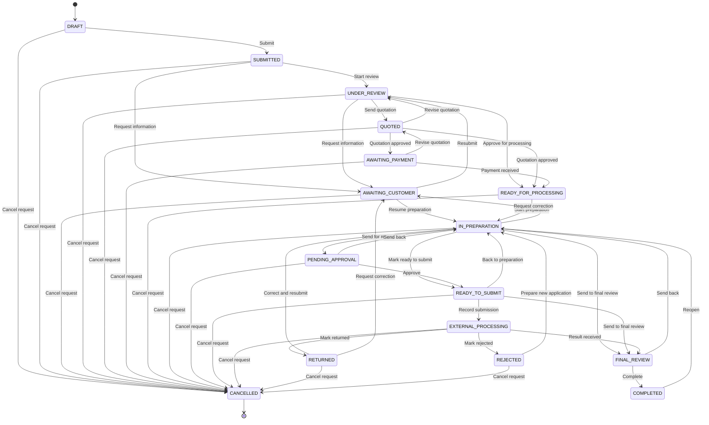

# Request lifecycle: the state machine and the workflow engine

This document describes how a service request (a "case") moves from draft to completed. It is written for
developers and for anybody who configures workflows. Everything in it is implemented in
`services/api/src/modules/requests` and `services/api/src/modules/workflows`.

There are two layers, and it is important to keep them apart:

| Layer | Question it answers | Who can change it | Where |
| --- | --- | --- | --- |
| **State machine** | "May this request go from status X to status Y, right now, for this actor?" | Nobody at runtime. It is code. | `packages/types/src/requests.ts` (the table), `request-state-machine.service.ts`, `request-guards.service.ts` |
| **Workflow engine** | "What is the next step for this request, who has to act, and is the step finished?" | Each centre, through the workflow builder. | `workflow-engine.service.ts`, workflow definitions in the database |

The engine never owns a status. It asks the state machine for a transition like every other caller, and the
state machine may refuse. That is the reason a centre can configure its workflow freely and still cannot
configure its way around a permission or a compliance rule.

## 1. Statuses

<!-- generated:status-table -->
| Status | Staff see | Customers see |
| --- | --- | --- |
| DRAFT | Draft | Draft — not submitted yet |
| SUBMITTED | New | Submitted |
| AWAITING_CUSTOMER | Awaiting customer | Action needed from you |
| UNDER_REVIEW | Documents under review | Documents under review |
| QUOTED | Quotation sent | Quotation ready for approval |
| AWAITING_PAYMENT | Awaiting payment | Payment required |
| READY_FOR_PROCESSING | Ready for processing | Queued for processing |
| IN_PREPARATION | In preparation | Being prepared |
| PENDING_APPROVAL | Pending review approval | Being prepared |
| READY_TO_SUBMIT | Ready to submit | Ready for submission |
| EXTERNAL_PROCESSING | External processing | Submitted — in processing |
| RETURNED | Returned | Returned for correction |
| REJECTED | Rejected | Application was not accepted |
| FINAL_REVIEW | Final review | Final checks |
| COMPLETED | Completed | Completed |
| CANCELLED | Cancelled | Cancelled |
<!-- /generated:status-table -->

`COMPLETED` and `CANCELLED` are terminal. A completed request can be reopened (`COMPLETED -> IN_PREPARATION`);
a cancelled request can not be revived.

Customers never see the difference between `IN_PREPARATION` and `PENDING_APPROVAL`: both read "Being prepared",
and history entries between two statuses with the same customer wording are not customer-visible.

## 2. The transition table

The diagram and the table below are generated from `REQUEST_TRANSITIONS`. A unit test
(`lifecycle-diagram.unit.spec.ts`) fails when this document and the table differ; run it with
`UPDATE_LIFECYCLE_DOC=1` to refresh the sections after a deliberate change of the table.

<!-- generated:state-diagram -->

<!-- /generated:state-diagram -->

<!-- generated:transition-table -->
| From | To | Action | Staff need one of | Customer | System | Reason required |
| --- | --- | --- | --- | --- | --- | --- |
| DRAFT | SUBMITTED | Submit | `request.create`, `request.update` | yes | - | - |
| DRAFT | CANCELLED | Cancel request | `request.cancel` | yes | - | yes |
| SUBMITTED | UNDER_REVIEW | Start review | `document.verify`, `request.process`, `request.update` | - | yes | - |
| SUBMITTED | AWAITING_CUSTOMER | Request information | `document.verify`, `request.process`, `request.update` | - | - | yes |
| SUBMITTED | CANCELLED | Cancel request | `request.cancel` | yes | - | yes |
| AWAITING_CUSTOMER | UNDER_REVIEW | Resubmit | `document.verify`, `request.update` | yes | yes | - |
| AWAITING_CUSTOMER | IN_PREPARATION | Resume preparation | `request.process` | - | yes | - |
| AWAITING_CUSTOMER | CANCELLED | Cancel request | `request.cancel` | yes | - | yes |
| UNDER_REVIEW | AWAITING_CUSTOMER | Request information | `document.verify`, `request.process` | - | - | yes |
| UNDER_REVIEW | QUOTED | Send quotation | `quotation.manage` | - | yes | - |
| UNDER_REVIEW | READY_FOR_PROCESSING | Approve for processing | `document.verify` | - | yes | - |
| UNDER_REVIEW | CANCELLED | Cancel request | `request.cancel` | yes | - | yes |
| QUOTED | AWAITING_PAYMENT | Quotation approved | - | - | yes | - |
| QUOTED | READY_FOR_PROCESSING | Quotation approved | - | - | yes | - |
| QUOTED | UNDER_REVIEW | Revise quotation | `quotation.manage` | - | yes | - |
| QUOTED | CANCELLED | Cancel request | `request.cancel` | yes | - | yes |
| AWAITING_PAYMENT | READY_FOR_PROCESSING | Payment received | - | - | yes | - |
| AWAITING_PAYMENT | QUOTED | Revise quotation | `quotation.manage` | - | yes | - |
| AWAITING_PAYMENT | CANCELLED | Cancel request | `request.cancel` | yes | - | yes |
| READY_FOR_PROCESSING | IN_PREPARATION | Start preparation | `request.process` | - | - | - |
| READY_FOR_PROCESSING | CANCELLED | Cancel request | `request.cancel` | - | - | yes |
| IN_PREPARATION | PENDING_APPROVAL | Send for review | `request.process` | - | - | - |
| IN_PREPARATION | READY_TO_SUBMIT | Mark ready to submit | `request.process` | - | - | - |
| IN_PREPARATION | FINAL_REVIEW | Send to final review | `request.process` | - | - | - |
| IN_PREPARATION | AWAITING_CUSTOMER | Request correction | `request.process` | - | - | yes |
| IN_PREPARATION | CANCELLED | Cancel request | `request.cancel` | - | - | yes |
| PENDING_APPROVAL | READY_TO_SUBMIT | Approve | `request.review` | - | - | - |
| PENDING_APPROVAL | IN_PREPARATION | Send back | `request.review` | - | - | yes |
| PENDING_APPROVAL | CANCELLED | Cancel request | `request.cancel` | - | - | yes |
| READY_TO_SUBMIT | EXTERNAL_PROCESSING | Record submission | `request.submit_external` | - | - | - |
| READY_TO_SUBMIT | FINAL_REVIEW | Send to final review | `request.process` | - | - | - |
| READY_TO_SUBMIT | IN_PREPARATION | Back to preparation | `request.process`, `request.review` | - | - | yes |
| READY_TO_SUBMIT | CANCELLED | Cancel request | `request.cancel` | - | - | yes |
| EXTERNAL_PROCESSING | FINAL_REVIEW | Result received | `request.process` | - | - | - |
| EXTERNAL_PROCESSING | RETURNED | Mark returned | `request.process` | - | - | yes |
| EXTERNAL_PROCESSING | REJECTED | Mark rejected | `request.process` | - | - | yes |
| EXTERNAL_PROCESSING | CANCELLED | Cancel request | `request.cancel` | - | - | yes |
| RETURNED | IN_PREPARATION | Correct and resubmit | `request.process` | - | - | - |
| RETURNED | AWAITING_CUSTOMER | Request correction | `request.process` | - | - | yes |
| RETURNED | CANCELLED | Cancel request | `request.cancel` | - | - | yes |
| REJECTED | IN_PREPARATION | Prepare new application | `request.process` | - | - | yes |
| REJECTED | CANCELLED | Cancel request | `request.cancel` | - | - | yes |
| FINAL_REVIEW | COMPLETED | Complete | `request.review`, `request.reopen` | - | - | - |
| FINAL_REVIEW | IN_PREPARATION | Send back | `request.review`, `request.process` | - | - | yes |
| COMPLETED | IN_PREPARATION | Reopen | `request.reopen` | - | - | yes |
<!-- /generated:transition-table -->

Reading the table:

- **Staff need one of**: the permissions that let a staff member use the edge. `-` means the edge can not be
  triggered by hand at all.
- **Customer**: the owning customer (or the administrator of the owning company) may use the edge on their own
  request. Customers can cancel only up to `AWAITING_PAYMENT`, i.e. before the request is released for
  processing.
- **System**: automation without a person deciding (jobs, the "resubmit" bookkeeping) may use the edge.
- **Reason required**: the caller must give a reason; it is stored in the history and shown to staff.

Any pair that is not in the table is refused with HTTP 409 `INVALID_TRANSITION`
("A request cannot go from X to Y."), for every actor, including the engine.

## 3. One transition, step by step

Every status change in the system goes through `RequestStateMachine.transition(tx, requestId, to, options)`.
Nothing else writes `service_requests.status` (a test scans the module for other writers). One call does the
following inside the caller's database transaction:

1. **Visibility.** For a signed-in actor the request must be inside their scope (branch, assignment, own
   customer record, own company). Otherwise the answer is 404, before anything about the request is revealed.
2. **Row lock.** `SELECT ... FOR UPDATE` on the request row. Two simultaneous transitions are serialised: the
   second one sees the status the first one wrote and is validated against it.
3. **Edge.** `findTransition(from, to)` must return a rule -> otherwise 409 `INVALID_TRANSITION`.
4. **Who.** See "authority" below -> 403 `FORBIDDEN`, `TRANSITION_NOT_ALLOWED` or `CANCELLATION_NOT_ALLOWED`.
5. **Optimistic version** (optional `version` from the client) -> 409 `STALE_VERSION`.
6. **Reason**, when the edge requires one -> 422 `REASON_REQUIRED`.
7. **Guards** (section 4) -> 422 with a specific code and a plain-language message.
8. **Write.** Status, timestamps (`submittedAt`, `completedAt`, `cancelledAt`), `version + 1`; the update is
   conditional on the status and version that were read.
9. **History.** One append-only `request_status_history` row: from, to, actor, actor type, internal reason,
   customer-visible flag, customer message (default: the customer wording of the new status) and `meta` with a
   per-request sequence number.
10. **Side effects that belong to the status itself**: plan usage and tracking code on submission, the pending
    review row on `PENDING_APPROVAL`, superseding earlier approvals on every entry into `IN_PREPARATION`,
    the outcome on the open external reference for `RETURNED` / `REJECTED`, the refund-review flag on
    cancellation.
11. **Audit** entry `request.status_changed`.
12. **Events**: `request.status_changed`, plus `request.submitted`, `request.information_requested`,
    `request.completed` or `request.cancelled`.
13. **Hooks**: the workflow engine follows the new status (section 6).

If any step fails, nothing of the transition is stored.

### Authority

| Authority | Used by | May use |
| --- | --- | --- |
| `CONTEXT` | every HTTP endpoint | staff: edges whose permission list contains one of their permissions. Customers / corporate administrators: edges marked "Customer", on their own requests. Jobs running as the system: edges marked "System". |
| `SYSTEM` | "resubmit" (the origin of the question decides where the request returns to) | edges marked "System" |
| `ENGINE` | the workflow engine, for the step it is executing | any edge of the table |

`ENGINE` is a value that only code inside the requests module constructs. No controller reads it from a
request; the generic endpoint `POST /requests/:id/transition` always uses `CONTEXT`. Whatever the authority,
steps 3 and 7 apply: the engine can not leave the table and can not skip a guard.

## 4. Guards

A guard looks only at the request and its facts, never at who is asking.

| Entering | From | Condition | Error code |
| --- | --- | --- | --- |
| `SUBMITTED` | `DRAFT` | The form validates against the form version pinned to the request. The plan limit `monthlyRequests` is not exhausted (HTTP 402). | `FORM_INVALID`, `PLAN_LIMIT_REACHED` |
| `UNDER_REVIEW` / `IN_PREPARATION` | `AWAITING_CUSTOMER` | The request returns to where the question was asked (preparation if it was asked during preparation or after a return, document review otherwise). No input document is still rejected. | `NOT_RELEASED_FOR_PROCESSING`, `RESUME_PREPARATION`, `REJECTED_DOCUMENTS_PENDING` |
| `UNDER_REVIEW` | `QUOTED` | No quotation is with the customer or approved any more. | `QUOTATION_PENDING` |
| `QUOTED` | `UNDER_REVIEW` | A quotation has been sent. | `QUOTATION_REQUIRED` |
| `QUOTED` | `AWAITING_PAYMENT` | The approved quotation has been replaced. | `QUOTATION_STILL_APPROVED` |
| `AWAITING_PAYMENT` | `QUOTED` | The quotation is approved. | `QUOTATION_NOT_APPROVED` |
| `READY_FOR_PROCESSING` | any | Every mandatory input document is VERIFIED or WAIVED and none is REJECTED. The payment policy is satisfied (below). From `QUOTED` additionally: the quotation is approved. | `DOCUMENTS_NOT_VERIFIED`, `DOCUMENTS_REJECTED`, `PAYMENT_REQUIRED`, `QUOTATION_NOT_APPROVED` |
| `IN_PREPARATION` | `READY_FOR_PROCESSING` | An operator is assigned. | `OPERATOR_REQUIRED` |
| `READY_TO_SUBMIT` | `IN_PREPARATION` | The case does not require review. | `APPROVAL_REQUIRED` |
| `READY_TO_SUBMIT` | `PENDING_APPROVAL` | A review is approved, it has not been superseded, and the approver is not the user of the current operator. | `APPROVAL_REQUIRED`, `SEGREGATION_OF_DUTIES` (403) |
| `EXTERNAL_PROCESSING` | `READY_TO_SUBMIT` | The service's compliance capability permits submission by the centre; an open submission reference with a permitted channel is recorded (partner channel: with the partner's name; official API: confirmed by a registered adapter); the review is approved when one is required. | `SUBMISSION_NOT_PERMITTED`, `EXTERNAL_REFERENCE_REQUIRED`, `CHANNEL_NOT_PERMITTED`, `PARTNER_NAME_REQUIRED`, `OFFICIAL_INTEGRATION_NOT_AVAILABLE`, `APPROVAL_REQUIRED` |
| `FINAL_REVIEW` | `IN_PREPARATION`, `READY_TO_SUBMIT` | The centre does not submit this service (capability `DOCUMENT_PREPARATION_ONLY` / `INFORMATIONAL_ONLY`), or the pinned workflow has no external-processing step that applies. From `IN_PREPARATION` additionally: the case does not require review. | `EXTERNAL_SUBMISSION_PENDING`, `APPROVAL_REQUIRED` |
| `FINAL_REVIEW` | `EXTERNAL_PROCESSING` | The result `COMPLETED` is recorded on the submission. | `EXTERNAL_RESULT_REQUIRED` |
| `COMPLETED` | `FINAL_REVIEW` | Every mandatory completion line has a document; the review is approved when one is required; the balance of the request's invoices is zero. | `COMPLETION_DOCUMENTS_MISSING`, `APPROVAL_REQUIRED`, `PAYMENT_INCOMPLETE` |

**"The case requires review"** means: the service snapshot says `requiresApproval`, or the workflow version of
the case contains an internal-approval step that applies to it. A workflow can therefore add a review; it can
never remove one.

**An approval stops counting** as soon as the request enters `IN_PREPARATION` again (review rejected, returned
by the authority, sent back from final review, reopened). The reworked application needs a fresh review.

**Payment policy** (frozen in the service snapshot when the request is created):

| Policy | Before processing (`READY_FOR_PROCESSING`) | Before completion (`COMPLETED`) |
| --- | --- | --- |
| `BEFORE_PROCESSING` | the request's invoices are fully paid | zero balance |
| `DEPOSIT` | paid >= `depositPercent` of the invoiced total (100% when no percentage is set) | zero balance |
| `AFTER_COMPLETION` | nothing | zero balance |

- "Paid" is net of refunds; drafts and void invoices do not count.
- A corporate request whose account is `ACTIVE` with `creditApproved` is invoiced on account and is never
  blocked by payment.
- No invoice is never treated as "paid". Before processing, a missing invoice blocks unless the approved
  quotation is zero. Before completion, a missing invoice blocks when an approved quotation above zero exists.
  (Finance announces `quotation.approved` before it creates the invoice; the request then waits in
  `AWAITING_PAYMENT` and continues on `invoice.issued` / `payment.completed`.)

**Cancellation never refunds.** It records the cancellation, ends the workflow execution and its open tasks,
and when the centre holds money for the request (payments minus refunds above zero) adds
`refundReviewNeeded: true` and `amountHeld` to the history `meta` and to the `request.cancelled` event, so
that finance follows up.

## 5. Workflows

A **workflow definition** has **versions**. At most one version is `PUBLISHED` (a database index enforces it)
and at most one is a `DRAFT`. Published and archived versions are never edited. A request is pinned to a
version id when it is created, and its execution to the same version when it is submitted:

- Publishing a new version changes nothing for running cases.
- New requests use the new version.
- **Rollback** creates and publishes a *copy* of an older version; it does not move a pointer back.
- **Migration** is explicit and per case (`POST /requests/:id/workflow/migrate`): the current step is matched
  by key. When the published version has no step with that key the migration is refused with
  `STEP_NOT_IN_TARGET` and the case stays where it is.

Every centre starts with three definitions copied from code templates (`workflow-templates.ts`):

| Key | Steps |
| --- | --- |
| `standard` (default) | form -> documents -> verification -> quotation -> customer approval -> payment -> prepare -> review (if `service.requiresApproval`) -> submission (if the capability is `PARTNER_COORDINATION` or `DIRECT_AUTHORISED`) -> completion |
| `walk-in-express` | documents -> verification -> quotation -> customer approval -> payment -> task -> completion |
| `pay-on-completion` | like `standard`, with the payment step just before completion (for services with policy `AFTER_COMPLETION` or `DEPOSIT`) |

A service uses its own `workflowDefinitionId`, or the centre default
(`tenant.settings.defaultWorkflowDefinitionId`).

### What the validator accepts

Checked when a draft is saved and when it is published (`validateWorkflow`, a pure function):

- at least one step, unique keys, every referenced key exists;
- exactly one Completion step, last, without a condition; every step reachable; every path ends at Completion;
- the default flow only moves forward; a branch may go back only to an earlier Staff task or Quotation;
  "on reject" exists only on approval steps and points to an earlier Staff task (internal approval) or
  Quotation (customer approval);
- Quotation before Customer approval; Quotation before Payment; a Staff task before External processing,
  Internal approval and Completion;
- assignee and escalation roles are staff roles of the centre; rule facts are in `WORKFLOW_FACTS`; operators
  are known and their operands have the right shape; timeouts are 1..2160 hours;
- branches exist on Conditional branch steps and nowhere else.

### Rules

`{ all?: Condition[], any?: Condition[] }` with `Condition = { fact, op, value }`. All of `all` must hold and,
when `any` is given, at least one of it. Operators: `eq`, `neq`, `in`, `nin`, `gt`, `gte`, `lt`, `lte`,
`exists`, `truthy`. Facts: `service.code`, `service.categoryKey`, `service.requiresApproval`,
`service.complianceCapability`, `service.paymentPolicy`, `branch.code`, `customer.type`, `customer.isCorporate`
(the request is billed to a company), `request.priority`, `request.source`, `documents.complete`,
`payment.status`, `quotation.total`, `assignee.roleKey`, `approval.result`. A step whose `conditions` are
false is recorded as `SKIPPED`.

## 6. The engine

`WorkflowEngine.advance(tx, requestId)` moves one request as far as the current facts allow:

```
lock the request row, then the execution row
loop:
  request CANCELLED / COMPLETED       -> close the execution and its tasks, stop
  request DRAFT / AWAITING_CUSTOMER   -> stop (nothing moves while the customer has to act)
  take the current step
  not entered yet:
      the step was already handled in this run -> the workflow runs in circles: mark the execution FAILED, stop
      conditions false (or submission not permitted for the service) -> record SKIPPED, next step
      otherwise record ACTIVE (startedAt, dueAt = now + timeoutHours)
  run the handler of the step type:
      WAIT      -> remember why (result.blocked), stop
      COMPLETE  -> record COMPLETED, close the step's tasks, next step
      SKIP      -> record SKIPPED, next step
      GOTO key  -> record COMPLETED, continue at that step
      FAIL      -> record FAILED; continue only if the step is optional
```

`advance` is called after every status change (state-machine hook), after every relevant domain event, after
checklist and form changes, and by the retry job `workflows.advance`. Each handler is a function of the
database state, so calling it any number of times gives the same result (tested). All writes are in the
caller's transaction.

When a handler wants a status change it asks the state machine with the `ENGINE` authority. A refusal is not
an error: the step stays active, the reason is stored in `workflow_step_executions.result.blocked` and shown
in the case view, and the next `advance` tries again.

| Step type | What the engine does | Finished when |
| --- | --- | --- |
| `CUSTOMER_FORM` | nothing | the form validates |
| `DOCUMENT_UPLOAD` | nothing | every mandatory input line has a document or is waived |
| `STAFF_VERIFICATION` | `SUBMITTED -> UNDER_REVIEW`. If a line is rejected while under review: `-> AWAITING_CUSTOMER` with a message naming the rejected documents | every mandatory input line is VERIFIED / WAIVED and none is rejected |
| `QUOTATION` | task "Prepare quotation" for the step's role | a quotation is sent; then `UNDER_REVIEW -> QUOTED` |
| `CUSTOMER_APPROVAL` | waits | the quotation is approved. Rejected, expired or withdrawn: `QUOTED -> UNDER_REVIEW` and back to the quotation step (new task) |
| `PAYMENT` | before processing: `QUOTED -> AWAITING_PAYMENT`; skipped when the policy needs nothing yet or corporate credit applies. Placed after processing it waits for the full balance. A revised quotation sends the case back to customer approval | the payment requirement holds; before processing the request is then released (`-> READY_FOR_PROCESSING`) |
| `STAFF_TASK` | releases the request (`-> READY_FOR_PROCESSING`, guards apply; falls back to `AWAITING_PAYMENT` when only the payment is missing), then creates the task for the operator | staff move the request out of preparation (send for review / ready to submit / final review), or mark "preparation done" (`POST .../workflow/complete-step`) |
| `INTERNAL_APPROVAL` | `IN_PREPARATION -> PENDING_APPROVAL`, binds the pending review row, task for the reviewer | the review is approved. Rejected: the request returns to `IN_PREPARATION` and the workflow to `onRejectStepKey` (default: the previous staff task) |
| `EXTERNAL_PROCESSING` | `IN_PREPARATION -> READY_TO_SUBMIT` when no review is needed; task "Submit application and record the reference". Skipped when the service can not be submitted by the centre | the result COMPLETED is recorded (`-> FINAL_REVIEW`). RETURNED / REJECTED keep the step open |
| `NOTIFICATION` | writes a history note with `config.message` and emits an informational `request.status_changed` (from = to) | immediately |
| `DOCUMENT_GENERATION` | builds a request summary PDF (pdfkit) and stores it through `DocumentStorePort` | stored. Without the port, or on an error: FAILED with a message; the workflow continues only when `config.optional` is true, otherwise the step is retried on later advances |
| `CONDITIONAL_BRANCH` | evaluates `branches` in order | immediately: first match -> `goTo`, else `nextStepKey` / the next step |
| `COMPLETION` | `-> FINAL_REVIEW` (guards apply), task "Final review" for the reviewer | the request is completed; the execution becomes COMPLETED |

**The status is the law, the workflow follows.** Examples:

- Staff release a request by hand while the engine waits for a quotation: the quotation, approval and payment
  steps are recorded as `SKIPPED (OVERTAKEN / NOT_DUE_YET)` and the staff task starts.
- Whenever the request enters `IN_PREPARATION` from a later status (review rejected, "correct and resubmit",
  sent back from final review, reopened), the execution returns to the preparation step before the step it was
  at; the abandoned step is recorded as `CANCELLED` (or `COMPLETED` with outcome `REJECTED` for a review).
  Each re-entry is a new `workflow_step_executions` row with `attempt + 1`: that table is the execution history.

### Reactions to events of other modules

Listeners run inside the emitting module's transaction, each in its own savepoint. If a reaction fails, its
own writes are rolled back, the other module's transaction continues, the error is logged and the job
`workflows.advance` retries after commit.

| Event | Reaction |
| --- | --- |
| `document.uploaded` | the checklist line named by `checklistItemId`, or the first MISSING (then REJECTED) line of that document type, becomes UPLOADED with the document |
| `document.verified` / `document.rejected` | every checklist line of an open request that uses the document becomes VERIFIED / REJECTED (with the reason) |
| `quotation.sent`, `quotation.approved`, `quotation.rejected` | advance |
| `invoice.issued`, `payment.completed`, `refund.completed` | `paymentStatus` is recomputed from the request's invoices, then advance |

Events about unknown, foreign or closed requests are ignored; a late payment on a cancelled request only
updates `paymentStatus`.

### Tasks, timeouts and escalation

Workflow tasks are rows in `tasks` with `source = 'WORKFLOW'`, the `stepKey`, the `roleKey` of the step and the
request's priority. Operator steps are assigned to the request's operator, review steps to its reviewer,
through `task_assignments`; reassigning the request moves the open tasks. A task is closed (`DONE`) when its
step completes and cancelled with the request.

The job `workflows.scan` runs every five minutes for every operational tenant:

- an ACTIVE step past `dueAt` without `escalatedAt` gets `escalatedAt`, an `ESCALATION` task for
  `escalateToRoleKey` (default `manager`) and the event `request.step_overdue`;
- an open request past `targetDate` gets an `ESCALATION` task with `stepKey = 'overdue'` and the event
  `request.overdue`. The task is the marker: it counts for the target date it was created after, so moving the
  target date re-arms the flag;
- a `QUOTED` request whose current quotation is `EXPIRED` is re-evaluated (finance marks the quotation expired
  without an event): `QUOTED -> UNDER_REVIEW` and back to the quotation step with a new task, as after a rejection.

All are claimed row by row, so running the job twice (or concurrently) escalates once.

## 7. Compliance can not be configured away

Requirement: "customer-configured workflows cannot bypass permissions or compliance restrictions". How it holds:

1. Every status change needs an edge of the table and passes the guards, whoever asks. The engine has no other
   way to change a status.
2. The guards read the **service snapshot** of the request (capability, `requiresApproval`, payment policy),
   not the workflow.
3. The engine skips an external-processing step for a service the centre may not submit, even when the
   workflow has the step unconditionally.
4. Recording a submission checks the capability and the channel before anything else.

Tested in `requests.engine.spec.ts` ("compliance is enforced by the engine, not by the workflow"): a workflow
consisting only of *staff task -> external processing -> completion*, attached to a preparation-only service
that requires review and payment before processing, still waits for verified documents, a paid invoice and an
approved review, and can not record a submission.

## 8. External processing

TypEase does not talk to any authority. Staff submit outside the system and record what happened; the
recorded status always carries its source.

| Capability of the service | Permitted channels |
| --- | --- |
| `DOCUMENT_PREPARATION_ONLY`, `INFORMATIONAL_ONLY` | none: the customer submits (422 `SUBMISSION_NOT_PERMITTED`) |
| `PARTNER_COORDINATION` | `AUTHORISED_PARTNER` (the partner's name is mandatory) |
| `DIRECT_AUTHORISED` | `MANUAL_PORTAL` (staff used the official portal with the centre's own authorised credentials and record the reference), `OFFICIAL_API` |

| Status source | Set when | Label shown with the status |
| --- | --- | --- |
| `STAFF_ENTERED` | staff record or update a status on a portal / API reference | "Entered by staff (not verified by the authority)" |
| `PARTNER_PROVIDED` | staff record or update a status on a partner reference | "Provided by partner" |
| `VERIFIED_OFFICIAL` | only by an `OfficialSubmissionPort` adapter | "Verified via official integration" |

`OFFICIAL_API` needs an `Integration` row of the tenant with category `GOVERNMENT`, status `ACTIVE` and
`authorisationVerifiedAt` set, **and** an adapter registered for its provider through the abstract
`OfficialSubmissionPort` (`official-submission.port.ts`). This code base contains no such adapter, so the
channel answers 422 `OFFICIAL_INTEGRATION_NOT_AVAILABLE`. An adapter is added by a deployment that holds
documented API access: implement the port against the official API and provide it in a global Nest module
(`{ provide: OfficialSubmissionPort, useClass: ... }`). The request bodies of the HTTP API are strict and have
no source field, so a client can never claim `VERIFIED_OFFICIAL`.

The outcome of a submission (`COMPLETED`, `RETURNED`, `REJECTED`) is stored in the reference's `status` and can
only be set by "record result" or by the corresponding transition; a later submission needs a new reference.
